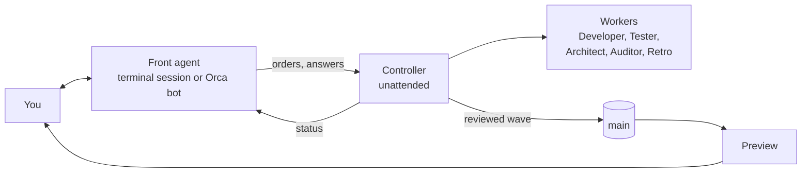

<h1 align="center">Agentic Factory</h1>

<p align="center">
  <strong>Build software with coordinated AI agents, and keep your overview.</strong><br>
  You talk to one agent. An unattended Controller runs the workers. Nothing reaches <code>main</code> without an independent review.
</p>

<p align="center">
  <a href="#quick-start">Quick start</a> ·
  <a href="#what-is-new">What is new</a> ·
  <a href="#update-a-project">Update</a> ·
  <a href="#what-has-run-for-real">Limits</a> ·
  <a href="#documentation">Documentation</a> ·
  <a href="docs/de/erste-schritte.md">Deutsch</a> ·
  <a href="CONTRIBUTING.md">Contributing</a>
</p>

---

## What it is

Agentic Factory is a way of working and the scripts that carry it: one human decides and accepts, one Front agent talks to them, an unattended Controller starts workers (Developer, Tester, Architect, Auditor, Retro) in their own git worktrees, and only reviewed work reaches `main`. The workers can be Claude Code, Codex or Pi. [Orca](https://github.com/stablyai/orca) runs the terminals and worktrees.

It is for one human, alone or speaking for a small team, who wants several agents to build features in parallel and still see one status. It adds a process of tickets, reviews, waves and gates. That costs setup and some waiting, so it is more than a one-file change needs.

## How it works



You see one status table and get questions with options. The Controller starts workers, runs reviews and waves, and cleans up. You accept the result on a local preview that follows `main`.

The Front agent is an agent session in an Orca terminal, or an Orca bot that Orca wakes when the Controller has news. A heartbeat job on the Controller's machine wakes an idle Controller and reports one that hangs.

## Why it holds up

| | |
|---|---|
| **Nobody accepts their own work** | A separate Tester reviews with fresh context and runs the gates itself. Git hooks refuse a push to `main` without a passing review. For code, the wave runs the full gate itself before it pushes; no earlier result stands in for it. |
| **Outside-in** | Surface, then data, then logic, each signed off by you before any code exists. |
| **Functionality first** | A review fails on real defects. The rest becomes categorised debt, worked off before a release. Review rounds are bounded (`reviews.maxRounds`, default 2): after the last one a working feature is integrated. |
| **Measured, not guessed** | Workers start by measured load. Model tiers follow pass rates. Gates run in fair slots. |
| **It runs unattended and says when it stops** | The heartbeat reports a hung Controller to the Front agent. Finished workers are recognised and their worktrees cleaned up. The Controller starts itself fresh when its context use passes a threshold. |
| **It improves itself** | An event journal, a nightly pipeline audit, a retro after hard runs, and a fast lane for small fixes. |
| **Nothing leaves the project** | No real data, no secrets, no sending, deploying or deleting, no `--no-verify`. |

## Quick start

**You need** macOS or Linux (on Windows, WSL 2), [Orca](https://github.com/stablyai/orca) running, one logged-in agent CLI (Claude Code, Codex or Pi), Node 22+, and git with your name and email set. A Linux server for the workers is optional.

**Open your project in that agent, in Orca if you can, and drop in this prompt:**

```text
Set up the agentic factory for this project. If ~/agentic-factory does not exist, clone https://github.com/bussard76/agentic-factory.git into it; otherwise update it with git -C ~/agentic-factory pull --ff-only. Then read ~/agentic-factory/START.md and follow it: check the prerequisites, move into Orca if needed, and guide me through the onboarding.
```

The agent follows [START.md](START.md), which holds the steps. It checks the prerequisites and moves into Orca if needed. It then asks the [onboarding questions](docs/onboarding.md), among them who the Front agent is (a terminal session, or an Orca bot that you create in Orca first) and where the Controller's files live, one directory per project. It then starts the Controller and guides your first feature.

<details>
<summary><strong>An existing project:</strong> use this prompt instead</summary>

```text
Set up the agentic factory for this project. If ~/agentic-factory does not exist, clone https://github.com/bussard76/agentic-factory.git into it; otherwise update it with git -C ~/agentic-factory pull --ff-only. Then read ~/agentic-factory/START.md and follow it: check the prerequisites, move into Orca if needed, and guide me through the onboarding.
This is an existing project. Before onboarding, make sure the working tree is clean and tell me if it is not. After init, merge every file that init kept as user-owned with its new version in .factory/new/ (AGENTS.md first): keep the project's own rules, add the factory's rules, and ask me where the two contradict. Show me the merged AGENTS.md before you commit it, and reference the adoption ADR in the commit message. If the push to the main branch is rejected, put the adoption commit on a branch and tell me so I can open a merge request.
```

`init` never overwrites your files: it keeps them and puts its own version in `.factory/new/`. Your hooks stay active and run first, and existing ADRs keep their numbers. The adoption commit goes directly to the main branch, so a protected branch rejects the push.

Reading this on GitLab? Put the project's clone URL into the prompt.

</details>

Prefer the terminal? [Getting started](docs/getting-started.md) has every step by hand, and the WSL setup.

**What `start` writes on your machine.** Outside the project it writes the user-level skills, `~/front-agent/<project>/`, the Controller's directory (default `~/controller`) with the project's own `gate`, `~/load.log`, a heartbeat job and, for a terminal Front agent, a status watch (launchd on a local macOS machine, cron elsewhere), with an Orca bot as Front agent a watch folder `~/front-agent/.bots/<bot>-<id>/` and one Orca automation for the bot instead of the status watch, and read permissions for lean-ctx or pi where they are installed. [The full list, with how to remove each item,](docs/getting-started.md#what-start-writes-on-your-machine) is in Getting started. Nothing goes to `~/.local/bin` any more.

**A second factory on the same machine** works when each project has its own Controller directory (`init` proposes `~/controller-<project>`). Gates, queues and slots are per project. Only the skills, the load log (every line carries its project) and the lean-ctx read list are shared. A separate `HOME` does not separate two factories, because Orca's terminals use the real one: [why](docs/getting-started.md#a-separate-home-does-not-isolate-a-second-factory).

## What is new

Recent changes, each with the place that documents it:

- **An Orca bot can be the Front agent.** `init` asks for the kind (`terminal` or `orca-bot`), the bot's name and the Controller's directory. [Orca](docs/orca.md#front-agent-as-an-orca-bot), [START.md](START.md).
- **Each project has its own gate** in its Controller directory. No project reads or writes a shared gate under `~/.local/bin` any more. [Getting started](docs/getting-started.md#what-start-writes-on-your-machine), [Testing](docs/testing.md#gates-run-in-fair-slots).
- **The Controller is woken more reliably.** On a local macOS Controller a new installation schedules the heartbeat through launchd (a cron line that is already there stays), and `start` fails with the reason if it cannot schedule it. The heartbeat wakes an idle Controller within a minute of a worker message, a finished wave or a new line in `inbox.md`. `inbox.md` is append-only: the Controller marks lines as handled with `node inbox.mjs --done`. [Orca: Heartbeat](docs/orca.md#heartbeat).
- **A hung Controller is reported, and can be restarted once.** The report to the Front agent is on. The automatic restart is off until you set `hosts.controller.hung.restart` to `true`. Above `hosts.controller.restart.contextPercent` (default 50) the Controller starts itself fresh. [Orca: Heartbeat](docs/orca.md#heartbeat).
- **Finished workers are recognised and cleaned up.** Orca's dispatch state decides, not the terminal list, so a worker that reported `worker_done` no longer fills the capacity cap or keeps its worktree. `node keep.mjs <key>` keeps one for you. **`cleanup.mjs` deletes only with `--apply`;** without it, it prints what it would remove. [Orca](docs/orca.md), [CONTROLLER.md](controller/CONTROLLER.md).
- **Gates and reviews.** The wave always runs the full gate for code. Review rounds are bounded, and after the last one a final functional re-evaluation decides. Two settings, both off by default: `docsOnly.enabled` lets a task whose ticket declares itself a documentation ticket (`Level: 1`, `Documentation only: yes`) and whose change touches only documentation skip its Tester round (its wave still runs the full gate; `init` asks whether to enable it), and `commands.formatStaged` formats staged files in the commit hook. What counts as documentation, and what stays on the full path, is in [Testing](docs/testing.md#documentation-only-changes). [Reviews](docs/reviews.md) covers the rounds.
- **The `agentic-factory` commands and the Node scripts of the Controller and Front-agent bundles take `--help` and refuse arguments they do not know** (exit code 2, before anything runs). `gate` and the git guardrails are the exceptions, and the shell scripts are not covered; [Getting started](docs/getting-started.md) names the first two.

## Update a project

A project has its own copy of the handbooks and hooks, so a newer factory reaches it only through an update. Drop this into the project's Front agent:

```text
Update this project to the newest agentic factory. Run git -C ~/agentic-factory pull --ff-only, then in this project run node ~/agentic-factory/bin/agentic-factory.mjs update. Show me what changed and every file it kept. Merge each kept file with its new version in .factory/new/ and ask me where they contradict. Commit the changes referencing the adoption ADR. A push to main needs a passing review, so put them on a branch and have the Controller review and merge them. Then run node ~/agentic-factory/bin/agentic-factory.mjs start and tell me whether the Controller needs a restart.
```

<details>
<summary><strong>The same by hand</strong></summary>

```bash
git -C ~/agentic-factory pull --ff-only
cd ~/path/to/your-project
node ~/agentic-factory/bin/agentic-factory.mjs update
git status
```

1. **Review.** `update` overwrites only files you have not changed. A changed file stays, and its new version lands in `.factory/new/` for you to merge. Merge the Controller's handbook, `.factory/controller/CONTROLLER.md`, first: an older one calls `cleanup.mjs` without `--apply`, so nothing is cleaned up, and does not know `inbox.mjs --done`. `update`, `start`, `status` and `doctor` warn when a kept handbook is behind.
2. **Commit, get it reviewed, then push.** `update` commits nothing. Protected files need the adoption ADR in the message, for example `Update agentic factory (ADR-0001)`. Only documentation reaches `main` without a review, and `docs/review-protocol.md`, `docs/architect-protocol.md` and `CODING_STANDARDS.md` do not count as documentation. An update also changes `.factory/manifest.json`, and often hooks and skills, so the pre-push hook refuses a direct push until a passing review covers the commit. Put it on a branch and hand it to the Controller.
3. **Run `start`:** `node ~/agentic-factory/bin/agentic-factory.mjs start`. A running Controller read its handbook when it started, so close its terminal once it is idle and run `start` again. Workers keep running. `update` does not touch the heartbeat's schedule; `start` does.

An older project has not chosen yet whether an Architect maintains an `ARCHITECTURE.md`. `status` asks; set `architecture.mode` to `architect` or `off` in `factory.config.json` and run `update` again.

To stay on a release instead of `main`, use `git -C ~/agentic-factory checkout <tag>`, for example `v0.1.12`. `pull --ff-only` then stops working until you run `git -C ~/agentic-factory switch main`.

</details>

## Good to know

- **The gates are local hooks.** They stop honest mistakes and are no security boundary. Protect `main` on the server too, with branch protection and a CI check.
- **The pre-push hook checks reviews, not gate runs.** That code reaches `main` only through the wave, and that the wave ran the full gate, is process. Only branch protection that admits the Controller's push alone would enforce it.
- **The secret scan and the test-count guard are heuristics.** Add a maintained scanner for anything sensitive.
- **GitHub-issue steering has less mileage than task files.** The plain-terminal runner is experimental and unsupported.
- **Preview: [keep the standard out of a project's history](docs/untracked-standard.md).** With `init --untracked-standard`, a project checks in only what is its own. It has not run on a real project yet.

Open points are in [`debt.md`](debt.md), and past reviews of this repository in [`docs/reviews/`](docs/reviews/).

## What has run for real

- **Run for real, twice:** end to end on macOS in a throwaway project, with a Claude Code Controller and an Orca bot as Front agent. The second run followed START.md alone: three tickets reached the main branch without a manual wake-up, and cleanup removed the workers by itself.
- **Not run for real since:** the last run was on a state before the latest heartbeat, cleanup and wave changes. Those are tested against fakes only.
- **Tested against fakes:** the test suite replaces Orca, ssh, `launchctl`, `crontab` and `gh` with fakes that record their calls. That is how the heartbeat, the wake rules, cleanup, capacity, the bot watch and the second-factory rules are tested.
- **Never run against a real Orca:** the automatic restart of a hung Controller (off by default). That closing the Controller's terminal leaves its workers alone is unproven. [Orca](docs/orca.md#heartbeat) lists what a restart kills and what is unproven.
- **Not tested again:** a remote Controller host, and a documentation-only wave on a remote worker host.
- **Opt-in and little mileage:** the documentation-only path did not apply in the second real run, because a task branch also carries its spec review and report; it now accepts those two files of the ticket and needs the ticket's own declaration, tested with fakes and reviewed, but no real run has used it since. The formatter on staged files was tested with a stand-in, not with `prettier` itself. Both are off until you turn them on.
- **Unproven:** why Orca read a Claude Code Controller at its prompt as busy for five minutes in one run. The heartbeat therefore does not guess from the screen. See "Busy or idle?" in [Orca](docs/orca.md#heartbeat).

## Documentation

| Read this | To learn |
|---|---|
| [START.md](START.md) | The steps the agent follows to set a project up |
| [Getting started](docs/getting-started.md) · [Erste Schritte](docs/de/erste-schritte.md) | From zero to the first reviewed change on `main`, what `start` writes, and how to remove it |
| [Onboarding](docs/onboarding.md) | What `init` asks and why |
| [Workflow](docs/workflow.md) · [Arbeitsweise](docs/de/workflow.md) | The whole process, for people |
| [Roles](docs/roles.md) | Who does what, and what each role never does |
| [Outside-in](docs/outside-in.md) | How a new feature gets from sketch to tickets |
| [Reviews](docs/reviews.md) · [Testing](docs/testing.md) | What fails a review, which tests run when, the gate, the documentation-only path |
| [Capacity](docs/capacity.md) · [Improvement](docs/improvement.md) | How load, models and the pipeline are measured |
| [Orca](docs/orca.md) · [Server setup](docs/server-setup.md) · [Steering modes](docs/steering-modes.md) | Running it: naming, the Orca bot, heartbeat, hung Controller, cleanup, hosts, tickets |
| [Decisions](docs/decisions.md) · [Learnings](docs/learnings.md) | Why it is the way it is |

The ten-minute overview, in German, is [`site/index.html`](site/index.html). Open the file in a browser.

## What is in this repository

```text
bin/          the CLI: init, update, start, status, doctor
controller/   the Controller's handbook and scripts: workers, waves, capacity, cleanup, heartbeat, inbox, restart
front-agent/  the Front agent's handbook and scripts: status watch, bot watch, relay, preview
templates/    what init copies into a project: handbooks, hooks, guardrails, templates
standard/     what the untracked standard installs in a clone (preview)
skills/       vendored skills with pinned sources and licenses
server/       setup for a Linux build server
docs/         the process, in English and in docs/de in German
site/         the one-page intro
```

## A start, not an end state

Version 0.1.12, first extracted on 2026-10-31 from a project that has run this way since 2026-10-27.

Each project adapts its copy, and `update` never overwrites those changes. The numbers in the config are starting values that get calibrated from measurements. A remote server and a day and night rhythm are options.

What proves itself in a project and helps others flows back as a pull request: as much standard as possible in the factory, as much individual as necessary in each project. See [CONTRIBUTING.md](CONTRIBUTING.md).

## License

MIT. Vendored skills keep their own licenses, see [`skills/SKILLS.md`](skills/SKILLS.md).
