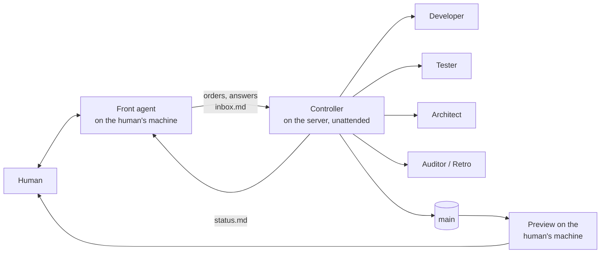

# agentic-factory

**A DevOps harness for building software with coordinated AI agents.**

One human. One agent that talks to them. One unattended controller that runs many workers on a server, with independent reviewers, measured capacity and a pipeline that audits and improves itself. Every rule in here was earned on a real project; every rule carries the decision and the reason behind it.

- **Intro:** the ten-minute overview, published with GitLab Pages at **https://gitlabci-pages.exxeta.info/agentic-factory-93b60a/** (GitLab login required; the page is `site/index.html`, in German).
- **Getting started, step by step:** [`docs/getting-started.md`](docs/getting-started.md) (English), [`docs/de/erste-schritte.md`](docs/de/erste-schritte.md) (Deutsch). From zero to the first reviewed change on `main`, all on your own machine.
- **Process for people:** [`docs/workflow.md`](docs/workflow.md) (English), [`docs/de/workflow.md`](docs/de/workflow.md) (Deutsch).
- **Set up a project:** start `claude "Read ~/agentic-factory/START.md and set up this project."` in your repo (see [Quick start](#quick-start)).

## What you get

| Part | What it is |
|---|---|
| **Roles** | Front agent (talks to the human), Controller (runs unattended), workers: Developer, Tester, Architect, Auditor, Retro. [`docs/roles.md`](docs/roles.md) |
| **Outside-in** | New features start with UI drafts and a clickable fake, then data in and out, then the logic as words and diagrams. Code comes last. [`docs/outside-in.md`](docs/outside-in.md) |
| **Reviews that bite** | Nobody accepts their own work. Reviews fail only on real functional defects; everything else becomes categorised debt for a hardening phase. Git refuses pushes to `main` without a passing review. [`docs/reviews.md`](docs/reviews.md) |
| **Test stages** | Developers check what they touched, Testers and waves run everything, Docker only at release. [`docs/testing.md`](docs/testing.md) |
| **Measured capacity** | The Controller starts workers by measured pressure, not by a fixed count. Gates run in fair slots. Models by complexity with an escalation ladder and a quota fallback. [`docs/capacity.md`](docs/capacity.md) |
| **Self-improvement** | An event journal, a nightly pipeline auditor, retros per hard agent run, a fast lane for small fixes. [`docs/improvement.md`](docs/improvement.md) |
| **Two steering modes** | GitHub issues, or task files with Orca. Same roles, same rules. [`docs/steering-modes.md`](docs/steering-modes.md) |
| **Tools** | Controller scripts (`controller/`), Front-agent scripts (`front-agent/`), git guardrails and project templates (`templates/`), server setup (`server/`), vendored skills (`skills/`). |

## Quick start

**Requirements**

| | |
|---|---|
| **Orca** (required) | [github.com/stablyai/orca](https://github.com/stablyai/orca), installed and running. The runner provides worktrees, terminals and messages. |
| **One agent CLI** | Codex, Claude Code or Pi, logged in. Workers, Controller and Front agent are sessions of these. |
| **Node 22+, git** | git configured with your name and email; the project is a git repository |
| optional | a Linux server for the Controller and workers ([`docs/server-setup.md`](docs/server-setup.md), about an hour); `gh` for GitHub-issue steering; Figma or Pencil for stage 1 of outside-in |

A plain-terminal runner without Orca exists behind `init --experimental-terminal-runner`. It is unsupported and not what the docs describe.

**The short way: one prompt.** Open your project in any agent (Claude Code, Codex or Pi; in Orca if you can) and drop in:

```text
Set up the agentic factory for this project. If ~/agentic-factory does not exist, clone https://github.com/bussard76/agentic-factory.git into it; otherwise update it with git -C ~/agentic-factory pull --ff-only. Then read ~/agentic-factory/START.md and follow it: check the prerequisites, move into Orca if needed, and guide me through the onboarding.
```

The agent checks Node, git, your git identity, Orca and the agent CLI and tells you what is missing. If it runs outside Orca, it registers the project with Orca, starts itself again in an Orca terminal and asks you to continue there.

**An existing project.** Use this prompt instead. Reading this on GitLab? Put the project's clone URL from Code → Clone into it.

```text
Set up the agentic factory for this project. If ~/agentic-factory does not exist, clone https://github.com/bussard76/agentic-factory.git into it; otherwise update it with git -C ~/agentic-factory pull --ff-only. Then read ~/agentic-factory/START.md and follow it: check the prerequisites, move into Orca if needed, and guide me through the onboarding.
This is an existing project. Before onboarding, make sure the working tree is clean and tell me if it is not. After init, merge every file that init kept as user-owned with its new version in .factory/new/ (AGENTS.md first): keep the project's own rules, add the factory's rules, and ask me where the two contradict. Show me the merged AGENTS.md before you commit it, and reference the adoption ADR in the commit message. If the push to the main branch is rejected, put the adoption commit on a branch and tell me so I can open a merge request.
```

`init` never overwrites your files. It keeps them and puts its own version in `.factory/new/`. Your git hooks stay active and run first, and existing ADRs keep their numbers. The adoption commit goes directly to the main branch, so a protected branch rejects the push.

**The same by hand.** With Orca running, paste this into a terminal (macOS, Linux, or WSL on Windows):

```bash
# 1. Get the factory (reading this on GitLab? use the project's clone URL from Code → Clone)
git clone https://github.com/bussard76/agentic-factory ~/agentic-factory

# 2. Go to your project (a new one: mkdir my-app && cd my-app && git init -b main && git commit --allow-empty -m "Initial commit")
cd ~/path/to/your-project

# 3. Register the project with Orca and start the Front agent in an Orca terminal
ORCA="${ORCA_CLI_COMMAND:-orca}"   # on Linux outside Orca's own terminals: ORCA=orca-ide
$ORCA repo add --path "$PWD"
$ORCA agent launch --agent claude --worktree "path:$PWD" --surface terminal --focus \
  --prompt "Read ~/agentic-factory/START.md and set up this project."
```

Use `--agent codex` or `--agent pi` if that is your logged-in CLI. The agent's tab opens in Orca; from then on you talk to it there. Adding a project that Orca already knows does no harm. **Windows:** the factory's scripts need a Unix shell, so run Orca's terminal on a WSL 2 distribution (`wsl --install -d Ubuntu` in an admin PowerShell), install Node 22, git and the agent CLI inside WSL, and keep the project in the WSL file system (`~/…`, not `/mnt/c/…`); the commands above stay the same. Native Windows shells are not supported. The Front agent asks the [onboarding questions](docs/onboarding.md) in conversation, creates the adoption commit, starts the Controller and checks the setup. It then reports the project phase and guides the first feature. The [manual CLI path](docs/getting-started.md#appendix-what-the-agent-does-for-you-and-how-to-do-it-by-hand) remains available; updates preserve edited files in `.factory/new/` for merging.

## Update a project that already uses the factory

Your project has its own copy of the handbooks and hooks, so a newer factory reaches it only through these steps. Drop this into the project's Front agent:

```text
Update this project to the newest agentic factory. Run git -C ~/agentic-factory pull --ff-only, then in this project run node ~/agentic-factory/bin/agentic-factory.mjs update. Show me what changed and every file it kept. Merge each kept file with its new version in .factory/new/ and ask me where they contradict. Commit the changes referencing the adoption ADR, push them, run node ~/agentic-factory/bin/agentic-factory.mjs start and tell me whether the Controller needs a restart.
```

Or by hand:

```bash
git -C ~/agentic-factory pull --ff-only          # the newest factory
cd ~/path/to/your-project
node ~/agentic-factory/bin/agentic-factory.mjs update
git status                                       # what update changed
```

1. **Review.** `update` overwrites only files you have not changed. It keeps a changed file and puts the new version in `.factory/new/`, so merge those by hand.
2. **Commit and push.** `update` commits nothing. Protected files need the adoption ADR in the commit message, for example `Update agentic factory (ADR-0001)`. The hooks and the review gate apply as usual.
3. **Hand it to the Controller:** `node ~/agentic-factory/bin/agentic-factory.mjs start` copies the new bundles to the Controller's directory and the skills to the host. Scripts take effect at their next call. A running Controller read its `CONTROLLER.md` when it started, so close its terminal once it is idle and run `start` again. Workers run in their own terminals and keep running.

Run this in each project. To stay on a release instead of `main`, use `git -C ~/agentic-factory checkout <tag>`, for example `v0.1.2`. `pull --ff-only` then no longer works until you switch back with `git -C ~/agentic-factory switch main`.

## Known limits (read before you trust the gates)

- The git guardrails are **local hooks**. They stop honest mistakes; they are not a security boundary. Protect `main` on the server side too (branch protection, a CI check). See [`debt.md`](debt.md).
- The staged-secret scan knows a handful of common patterns. Add a maintained scanner for anything sensitive.
- The test-count guard is a heuristic: it counts test calls in test files. A dummy test keeps the count.
- GitHub-issue steering has had less mileage than task files; the plain-terminal runner is experimental and unsupported.
- An independent review of this repo and its findings are in `docs/reviews/`; what is not fixed yet is in [`debt.md`](debt.md).

## How it works, in one picture



The human talks only to the Front agent and sees one status table. The Controller reads the human's answers from `inbox.md`, runs workers, reviews, waves and cleanup, and writes `status.md`. Work flows to `main` only through a wave with passing reviews. The human tests on a local preview that follows `main` on its own.

## Principles

1. **Functionality first, hardening before release.** A review fails only when a specified flow does not work, data is lost, or a change would reach a real external system. Code quality and architecture conformance are checked in every review (an architecture violation blocks). Load and security tests do not run in daily gates, because they slow development down; they run in the hardening phase and before every release, as a condition of release approval.
2. **Outside-in.** Agree the surface, then the data, then the logic, each signed off by the human, before any code.
3. **Back pressure, not trust.** The reviewer is never the builder. The reviewer runs the gates itself. Git enforces review coverage on `main`.
4. **Measure, then decide.** Capacity, flakiness and process changes come from the journal and the load log, not from feelings.
5. **Decisions are written down the moment they are made**, with who decided and why, in the project's handbooks.
6. **The factory has no outward effects.** Agents and their tests change nothing outside the repository and the demo or test environment: no production systems, no real accounts, no real data, no sending, deploying or deleting. Whether and how the *product* acts on external systems is a product decision of the project, recorded in its own docs.
7. **No real data, no secrets, no `--no-verify`.** Ever.

## Repository layout

```
bin/            the CLI: init (onboarding), update, doctor
docs/           the process, for people (EN) and docs/de (DE)
templates/      files that init copies into a project (handbooks, hooks, guardrails, task and ADR templates)
controller/     the Controller handbook and its scripts (start, wait, stall watch, wave, cleanup, capacity, gate, journal, spec templates)
front-agent/    the Front agent handbook and its scripts (status watch, relay, preview updater)
server/         scripts that set up a Linux build server with Docker, Node, the agent CLIs and Orca
skills/         vendored skills with pinned sources and licenses (ponytail, engineering skills, retro, wayfinder, prototype)
scripts/        repository tools (skills-check: compare vendored skills with upstream)
site/           the single-page intro
```

## A start, not an end state

Version 0.1.2, first extracted on 2026-10-31 from a project that has run this way since 2026-10-27. It is meant as a **starting point**:

- every project gets its own copy through `init` and changes it freely; `update` brings newer factory versions in without overwriting local changes (new versions land in `.factory/new/` for you to merge)
- what proves itself in a project flows back into the factory as a pull request
- the numbers in the config (capacity, models, rounds) are starting values that the factory calibrates from measurements
- a remote server and the day/night rhythm are options; Orca is required

The tools target Linux servers and macOS, with Orca as the runner everywhere.

## License

MIT. Vendored skills keep their own MIT licenses, see [`skills/SKILLS.md`](skills/SKILLS.md).
