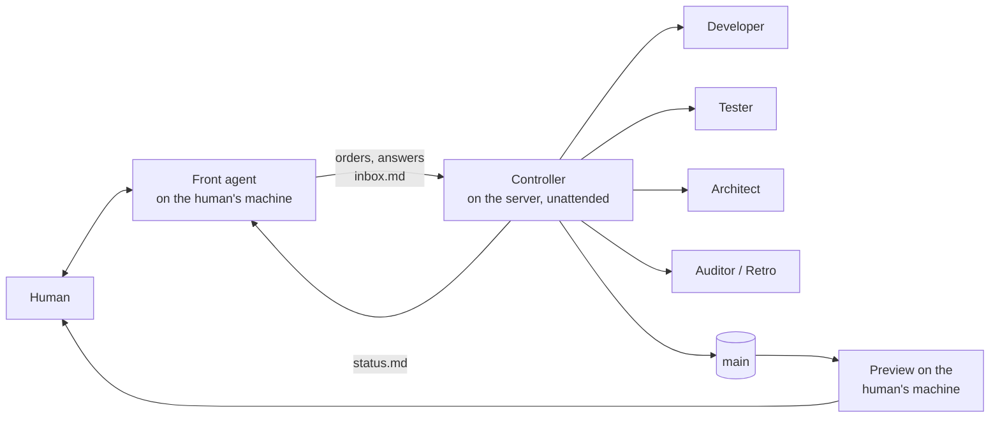

# agentic-factory

**A DevOps harness for building software with coordinated AI agents.**

One human. One agent that talks to them. One unattended controller that runs many workers on a server, with independent reviewers, measured capacity and a pipeline that audits and improves itself. Every rule in here was earned on a real project; every rule carries the decision and the reason behind it.

- **Intro:** open [`site/index.html`](site/index.html) for the ten-minute overview.
- **Getting started, step by step:** [`docs/getting-started.md`](docs/getting-started.md) (English), [`docs/de/erste-schritte.md`](docs/de/erste-schritte.md) (Deutsch). From zero to the first reviewed change on `main`, all on your own machine.
- **Process for people:** [`docs/workflow.md`](docs/workflow.md) (English), [`docs/de/workflow.md`](docs/de/workflow.md) (Deutsch).
- **Set up a project:** `npx agentic-factory init` in your repo (see [Quick start](#quick-start)).

## What you get

| Part | What it is |
|---|---|
| **Roles** | Front agent (talks to the human), Controller (runs unattended), workers: Developer, Tester, Architect, Auditor, Retro. [`docs/roles.md`](docs/roles.md) |
| **Outside-in** | New features start with UI drafts and a clickable fake, then data in and out, then the logic as words and diagrams. Code comes last. [`docs/outside-in.md`](docs/outside-in.md) |
| **Reviews that bite** | Nobody accepts their own work. Reviews fail only on real functional defects; everything else becomes categorised debt for a hardening phase. Git refuses pushes to `main` without a passing review. [`docs/reviews.md`](docs/reviews.md) |
| **Test stages** | Developers check what they touched, Testers and waves run everything, Docker only at release. [`docs/testing.md`](docs/testing.md) |
| **Measured capacity** | The Controller starts workers by measured pressure, not by a fixed count. Gates run in fair slots. Models by complexity with an escalation ladder and a quota fallback. [`docs/capacity.md`](docs/capacity.md) |
| **Self-improvement** | An event journal, a nightly pipeline auditor, retros per hard agent run, a fast lane for small fixes. [`docs/improvement.md`](docs/improvement.md) |
| **Two steering modes** | GitHub issues, or task files with Orca. Same roles, same rules. [`docs/steering-modes.md`](docs/steering-modes.md) |
| **Tools** | Controller scripts (`controller/`), Front-agent scripts (`front-agent/`), git guardrails and project templates (`templates/`), server setup (`server/`), vendored skills (`skills/`). |

## Quick start

Requirements: Node 22+, git, and at least one agent CLI (Codex, Claude Code or Pi). For the server-side controller you also want a Linux box; [`docs/server-setup.md`](docs/server-setup.md) sets one up in about an hour.

```bash
cd your-project
npx github:<your-fork>/agentic-factory init     # or: npx agentic-factory init, once published
```

`init` is the onboarding. It asks the questions a new project has to answer, writes `factory.config.json`, copies the handbooks, templates, hooks and skills into your repo, and prints the next steps for the human (logins, pairing, loading the preview). It never touches an existing file without showing the diff. [`docs/onboarding.md`](docs/onboarding.md) explains every question.

Then, on **every machine that runs a Controller or a Front agent**:

```bash
npx agentic-factory install-skills   # the Orca skills (orchestration, orca-cli) and the coordination skills at user level
```

Those two sessions run outside the project repo and cannot see its `.agents/skills`. Without the Orca skills an agent cannot start, watch or release workers; this is the one step people forget.

Later:

```bash
npx agentic-factory update    # pull newer templates and scripts, shown as a diff first
npx agentic-factory doctor    # check hosts, tools, hooks, user-level skills and config
```

## How it works, in one picture



The human talks only to the Front agent and sees one status table. The Controller reads the human's answers from `inbox.md`, runs workers, reviews, waves and cleanup, and writes `status.md`. Work flows to `main` only through a wave with passing reviews. The human tests on a local preview that follows `main` on its own.

## Principles

1. **Functionality first.** A review fails only when a specified flow does not work, data is lost, or something real would leave the system. Tests, edge cases, security, load and style become debt with a category and a follow-up, worked off in a hardening phase.
2. **Outside-in.** Agree the surface, then the data, then the logic, each signed off by the human, before any code.
3. **Back pressure, not trust.** The reviewer is never the builder. The reviewer runs the gates itself. Git enforces review coverage on `main`.
4. **Measure, then decide.** Capacity, flakiness and process changes come from the journal and the load log, not from feelings.
5. **Decisions are written down the moment they are made**, with who decided and why, in the project's handbooks.
6. **Nothing real leaves the system without the human's click.** No sending, posting, inviting or deleting in anything external.
7. **No real data, no secrets, no `--no-verify`.** Ever.

## Repository layout

```
bin/            the CLI: init (onboarding), update, doctor
docs/           the process, for people (EN) and docs/de (DE)
templates/      files that init copies into a project (handbooks, hooks, guardrails, task and ADR templates)
controller/     the Controller handbook and its scripts (start, wait, stall watch, wave, cleanup, capacity, gate, journal, spec templates)
front-agent/    the Front agent handbook and its scripts (status watch, relay, preview updater)
server/         scripts that set up a Linux build server with Docker, Node, the agent CLIs and Orca
skills/         vendored skills with pinned sources and licenses (ponytail, engineering skills, retro, wayfinder, prototype)
site/           the single-page intro
```

## A start, not an end state

Version 0.1.0, extracted on 2026-10-31 from a project that has run this way since 2026-10-27. It is meant as a **starting point**:

- every project gets its own copy through `init` and changes it freely; `update` brings newer factory versions in without overwriting local changes (new versions land in `.factory/new/` for you to merge)
- what proves itself in a project flows back into the factory as a pull request
- the numbers in the config (capacity, models, rounds) are starting values that the factory calibrates from measurements
- a remote server is an option, not a must; so is the day/night rhythm; so is Orca

The tools target Linux servers (Orca or plain terminals) and macOS for the Front agent. Expect rough edges in `terminal` runner mode; `orca` mode is the one in daily use.

## License

MIT. Vendored skills keep their own MIT licenses, see [`skills/SKILLS.md`](skills/SKILLS.md).
