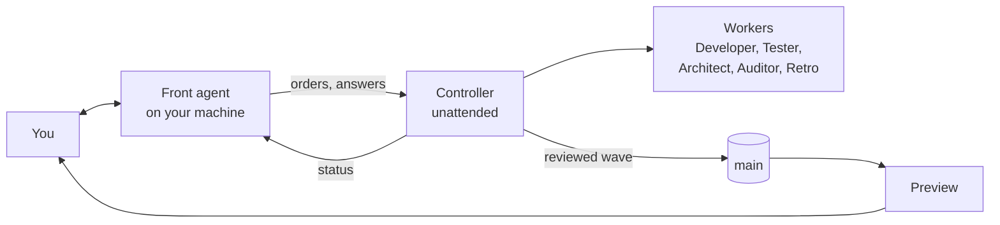

<h1 align="center">Agentic Factory</h1>

<p align="center">
  <strong>Build software with coordinated AI agents, and keep your overview.</strong><br>
  You talk to one agent. An unattended Controller runs the workers. Nothing reaches <code>main</code> without an independent review.
</p>

<p align="center">
  <a href="#quick-start">Quick start</a> ·
  <a href="#update-a-project">Update</a> ·
  <a href="#documentation">Documentation</a> ·
  <a href="docs/de/erste-schritte.md">Deutsch</a> ·
  <a href="CONTRIBUTING.md">Contributing</a>
</p>

---

## How it works



You see one status table and get questions with options. The Controller starts workers, runs reviews and waves, and cleans up. You accept the result on a local preview that follows `main`.

## Why it holds up

| | |
|---|---|
| **Nobody accepts their own work** | A separate Tester reviews with fresh context and runs the gates itself. Git hooks refuse a push to `main` without a passing review. |
| **Outside-in** | Surface, then data, then logic, each signed off by you before any code exists. |
| **Functionality first** | A review fails on real defects. The rest becomes categorised debt, worked off before a release. |
| **Measured, not guessed** | Workers start by measured load. Model tiers follow pass rates. Gates run in fair slots. |
| **It improves itself** | An event journal, a nightly pipeline audit, a retro after hard runs, and a fast lane for small fixes. |
| **Nothing leaves the project** | No real data, no secrets, no sending, deploying or deleting, no `--no-verify`. |

## Quick start

**You need** macOS or Linux (on Windows, WSL 2), [Orca](https://github.com/stablyai/orca) running, one logged-in agent CLI (Claude Code, Codex or Pi), Node 22+ and git. A Linux server for the workers is optional.

**Open your project in that agent, in Orca if you can, and drop in this prompt:**

```text
Set up the agentic factory for this project. If ~/agentic-factory does not exist, clone https://github.com/bussard76/agentic-factory.git into it; otherwise update it with git -C ~/agentic-factory pull --ff-only. Then read ~/agentic-factory/START.md and follow it: check the prerequisites, move into Orca if needed, and guide me through the onboarding.
```

The agent checks the prerequisites and moves into Orca if needed. It then asks the [onboarding questions](docs/onboarding.md), starts the Controller and guides your first feature.

<details>
<summary><strong>An existing project:</strong> use this prompt instead</summary>

```text
Set up the agentic factory for this project. If ~/agentic-factory does not exist, clone https://github.com/bussard76/agentic-factory.git into it; otherwise update it with git -C ~/agentic-factory pull --ff-only. Then read ~/agentic-factory/START.md and follow it: check the prerequisites, move into Orca if needed, and guide me through the onboarding.
This is an existing project. Before onboarding, make sure the working tree is clean and tell me if it is not. After init, merge every file that init kept as user-owned with its new version in .factory/new/ (AGENTS.md first): keep the project's own rules, add the factory's rules, and ask me where the two contradict. Show me the merged AGENTS.md before you commit it, and reference the adoption ADR in the commit message. If the push to the main branch is rejected, put the adoption commit on a branch and tell me so I can open a merge request.
```

`init` never overwrites your files: it keeps them and puts its own version in `.factory/new/`. Your hooks stay active and run first, and existing ADRs keep their numbers. The adoption commit goes directly to the main branch, so a protected branch rejects the push.

Reading this on GitLab? Put the project's clone URL into the prompt.

</details>

Prefer the terminal? [Getting started](docs/getting-started.md) has every step by hand, and the WSL setup.

## Update a project

A project has its own copy of the handbooks and hooks, so a newer factory reaches it only through an update. Drop this into the project's Front agent:

```text
Update this project to the newest agentic factory. Run git -C ~/agentic-factory pull --ff-only, then in this project run node ~/agentic-factory/bin/agentic-factory.mjs update. Show me what changed and every file it kept. Merge each kept file with its new version in .factory/new/ and ask me where they contradict. Commit the changes referencing the adoption ADR. A push to main needs a passing review, so put them on a branch and have the Controller review and merge them. Then run node ~/agentic-factory/bin/agentic-factory.mjs start and tell me whether the Controller needs a restart.
```

<details>
<summary><strong>The same by hand</strong></summary>

```bash
git -C ~/agentic-factory pull --ff-only
cd ~/path/to/your-project
node ~/agentic-factory/bin/agentic-factory.mjs update
git status
```

1. **Review.** `update` overwrites only files you have not changed. A changed file stays, and its new version lands in `.factory/new/` for you to merge.
2. **Commit, get it reviewed, then push.** `update` commits nothing. Protected files need the adoption ADR in the message, for example `Update agentic factory (ADR-0001)`. Only documentation reaches `main` without a review, and `docs/review-protocol.md`, `docs/architect-protocol.md` and `CODING_STANDARDS.md` do not count as documentation. An update also changes `.factory/manifest.json`, and often hooks and skills, so the pre-push hook refuses a direct push until a passing review covers the commit. Put it on a branch and hand it to the Controller.
3. **Run `start`:** `node ~/agentic-factory/bin/agentic-factory.mjs start`. A running Controller read its handbook when it started, so close its terminal once it is idle and run `start` again. Workers keep running.

An older project has not chosen yet whether an Architect maintains an `ARCHITECTURE.md`. `status` asks; set `architecture.mode` to `architect` or `off` in `factory.config.json` and run `update` again.

To stay on a release instead of `main`, use `git -C ~/agentic-factory checkout <tag>`, for example `v0.1.10`. `pull --ff-only` then stops working until you run `git -C ~/agentic-factory switch main`.

</details>

## Good to know

- **The gates are local hooks.** They stop honest mistakes and are no security boundary. Protect `main` on the server too, with branch protection and a CI check.
- **The secret scan and the test-count guard are heuristics.** Add a maintained scanner for anything sensitive.
- **GitHub-issue steering has less mileage than task files.** The plain-terminal runner is experimental and unsupported.
- **Preview: [keep the standard out of a project's history](docs/untracked-standard.md).** With `init --untracked-standard`, a project checks in only what is its own. It has not run on a real project yet.

Open points are in [`debt.md`](debt.md), and past reviews of this repository in [`docs/reviews/`](docs/reviews/).

## Documentation

| Read this | To learn |
|---|---|
| [Getting started](docs/getting-started.md) · [Erste Schritte](docs/de/erste-schritte.md) | From zero to the first reviewed change on `main` |
| [Workflow](docs/workflow.md) · [Arbeitsweise](docs/de/workflow.md) | The whole process, for people |
| [Roles](docs/roles.md) | Who does what, and what each role never does |
| [Outside-in](docs/outside-in.md) | How a new feature gets from sketch to tickets |
| [Reviews](docs/reviews.md) · [Testing](docs/testing.md) | What fails a review, and which tests run when |
| [Capacity](docs/capacity.md) · [Improvement](docs/improvement.md) | How load, models and the pipeline are measured |
| [Orca](docs/orca.md) · [Server setup](docs/server-setup.md) · [Steering modes](docs/steering-modes.md) | Running it: naming, heartbeat, hosts, tickets |
| [Decisions](docs/decisions.md) · [Learnings](docs/learnings.md) | Why it is the way it is |

The ten-minute overview, in German, is [`site/index.html`](site/index.html). Open the file in a browser.

## What is in this repository

```text
bin/          the CLI: init, update, start, status, doctor
controller/   the Controller's handbook and scripts: workers, waves, capacity, cleanup, heartbeat
front-agent/  the Front agent's handbook and scripts: status watch, relay, preview
templates/    what init copies into a project: handbooks, hooks, guardrails, templates
standard/     what the untracked standard installs in a clone (preview)
skills/       vendored skills with pinned sources and licenses
server/       setup for a Linux build server
docs/         the process, in English and in docs/de in German
site/         the one-page intro
```

## A start, not an end state

Version 0.1.10, first extracted on 2026-10-31 from a project that has run this way since 2026-10-27.

Each project adapts its copy, and `update` never overwrites those changes. The numbers in the config are starting values that get calibrated from measurements. A remote server and a day and night rhythm are options.

What proves itself in a project and helps others flows back as a pull request: as much standard as possible in the factory, as much individual as necessary in each project. See [CONTRIBUTING.md](CONTRIBUTING.md).

## License

MIT. Vendored skills keep their own licenses, see [`skills/SKILLS.md`](skills/SKILLS.md).
