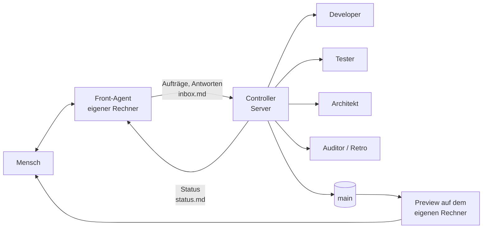
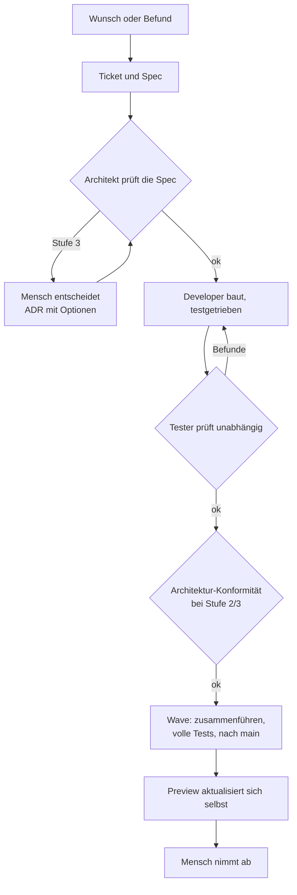
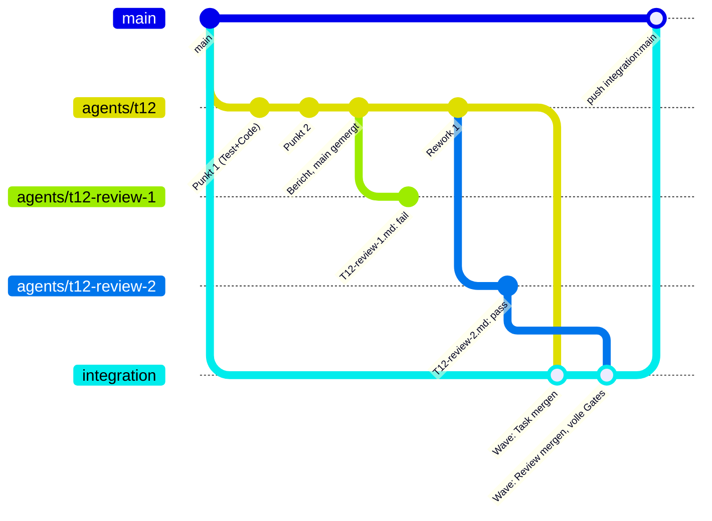

# Der Dev-Workflow: wie mit dieser Fabrik entwickelt wird

_Platzhalter in `{{…}}` füllt `init` aus; die gerenderte Fassung ist die `docs/dev-workflow.md` deines Projekts._

**Für wen:** Menschen, die verstehen wollen, wie ein Projekt mit agentic-factory gebaut wird, auch Dritte ohne Vorwissen.
**Verbindlich** für die Agenten eines Projekts sind dessen `AGENTS.md`, `docs/coordinator.md` (Regeln und Entscheidungshistorie), `docs/review-protocol.md` und `docs/architect-protocol.md`. Diese Datei fasst sie verständlich zusammen und muss mit ihnen übereinstimmen.

## Auf einen Blick

Ein Projekt wird von einer kleinen **agentischen Fabrik** gebaut:

- **Der Mensch** sagt, was gebraucht wird, testet und entscheidet. Er spricht nur mit einem Agenten, dem **Front-Agent**.
- Der **Controller** läuft unbeaufsichtigt auf einem Server. Er verteilt die Arbeit an viele **Worker** (KI-Agenten), taktet Prüfungen und bringt fertige Arbeit nach `main`, auch nachts.
- **Qualität entsteht durch Gegendruck:** Niemand nimmt seine eigene Arbeit ab. Jede Änderung prüft ein unabhängiger Tester. Git lehnt ungeprüften Code auf `main` technisch ab.



## Rollen

| Rolle | Wer / wo | Macht | Macht nie |
|---|---|---|---|
| **Mensch** | der Eigentümer | Ziele und Prioritäten, nimmt auf dem Preview ab (eigener Rechner, eigene Umgebung; automatisierte Tests nutzen nie echte Daten), entscheidet Architektur auf Stufe 3 und alles, was echte externe Systeme oder echte Daten berührt | – |
| **Front-Agent** | Agenten-Sitzung auf dem Rechner des Menschen, oder ein Orca-Bot dort (`hosts.frontAgent.kind: orca-bot`) | Einzige Ansprechstelle. Nimmt Wünsche und Testbefunde auf, macht daraus Tickets und Specs, führt die Stufen von außen nach innen, holt Entscheidungen ein, berichtet den Stand als Tabelle, schreibt die Morgen-Übergabe | Worker selbst steuern; den Menschen mit dem Hin und Her der Worker belasten |
| **Controller** | Agenten-Sitzung auf dem Server, unbeaufsichtigt | Startet und steuert alle Worker, taktet Tests, Reviews und Waves, erkennt hängende Worker, räumt auf, schreibt nach jedem Zyklus einen Status | Mit dem Menschen direkt sprechen; Stufe-3-Architektur, ADRs oder Produktentscheidungen treffen |
| **Developer** | Worker (Codex, Claude Code oder Pi) | Baut genau einen Auftrag, testgetrieben, auf eigenem Branch | Nach `main` pushen, Tests abschwächen |
| **Tester** | Worker, nie derselbe wie der Developer | Prüft unabhängig gegen die Spec, führt die vollen Testläufe aus, schreibt einen Befund mit Urteil | Code ändern |
| **Architekt** | Worker | Prüft Specs vor dem Bau und die Umsetzung danach gegen die Architektur | Code ändern; Stufe 3 entscheiden |
| **Auditor / Retro** | Worker, nur lesend | Wertet aus, wo die Fabrik Zeit verliert oder Fehler macht, und schlägt Verbesserungen vor | Etwas ändern |

Worker tragen Namen nach Aufgabe und Rolle, zum Beispiel „T22-S5 · Worker Developer“. Alle Namensregeln stehen in [Orca](../orca.md#naming).

**Worker fragen nie den Menschen.** Niemand liest den Chat eines Workers; eine Frage dort (das Frage-Werkzeug der Agenten-CLI oder eine Eingabeaufforderung, die auf Antwort wartet) hält den Worker an, bis es jemand merkt. Jede Spec endet mit demselben Block (`questionBlock` in `controller/lib.mjs`, `mkspec.mjs` setzt ihn in jede Rolle, auch Audit und Retro; `templates/AGENTS.md` sagt es ebenfalls): Fragen gehen mit `orca orchestration ask` an den Controller, der Worker macht mit allem weiter, was nicht von der Antwort abhängt, und der Controller beantwortet sie oder gibt sie an den Front-Agenten weiter. Mit dem Terminal-Runner startet der Worker außerdem ohne das Werkzeug, wo seine CLI einen Schalter dafür hat; unter dem Orca-Runner sind der Block und die Erkennung „wartet auf einen Menschen“ die Schichten (siehe [Orca](../orca.md#workers-never-ask-the-human), englisch).

## Von außen nach innen

Neue Funktionen entstehen **von außen nach innen**. Gebaut wird erst, wenn Oberfläche, Daten und Logik mit dem Menschen abgestimmt sind.

| Stufe | Was entsteht | Werkzeug | Freigabe |
|---|---|---|---|
| **1. Oberfläche** | grafische Entwürfe im Design-Werkzeug (Figma per MCP oder Pencil), dann ein **Frontend-Fake**: durchklickbar, erfundene Daten, ein paar Dummy-Aktionen, keine echte Logik | Design-MCP, `prototype` | So sieht es aus und so bedient es sich |
| **2. Schnittstellen** | welche Daten rein- und rausgehen: Quellen, Werkzeuge, Felder, Zustände (leer, mehrdeutig, Fehler), was das System schreibt | am Fake sichtbar gemacht | Diese Daten fließen hier |
| **3. Logik** | der Ablauf in Worten und als **Ablaufdiagramm** (Mermaid) | `grilling` / `grill-with-docs` für einzelne Fragen; `prototype` (Logik-Zweig) für Verhalten, das auf Papier schwer zu beurteilen ist; `wayfinder` für größere Vorhaben über mehrere Sitzungen | So denkt und handelt das System |
| **4. Bauen** | Spec aus Stufe 1–3, Tickets, jedes Ticket **geschärft** und als fertig markiert ([unten](#das-ticket-schärfen)), dann Architekt, Developer, Tester, Wave | `to-spec`, `to-tickets`, `grill-with-docs`, Controller | die Antworten auf offene Fragen; Abnahme auf dem Preview gegen den Fake |

- Die Stufen 1–3 erarbeitet der Front-Agent tagsüber mit dem Menschen. Der Controller baut nur, was alle drei Stufen durchlaufen hat.
- **Fehler an bereits abgestimmtem Verhalten** gehen weiter direkt als Ticket in den Bau.
- **Design-Export ins Repo:** Das Design-Werkzeug läuft nur auf dem Rechner des Menschen. Bei der Freigabe von Stufe 1 exportiert der Front-Agent Ebenenbaum, Design-Variablen, generierten Code und Screenshots nach `design/<feature>/`. Worker lesen den Entwurf aus Git und brauchen keinen Zugang zum Design-Werkzeug.
- **`wayfinder`** plant ein großes Vorhaben als Karte von Entscheidungstickets und löst sie Sitzung für Sitzung. Er plant nur, er baut nicht.
- **Grund:** Die Live-Fehler, die zu dieser Regel führten, waren fast alle Missverständnisse über Daten und Logik. Sie wären in Stufe 2 oder 3 vor dem Bau aufgefallen.
- **Design-Spur:** Wenn der Mensch darum bittet, formt der Front-Agent eine Oberfläche direkt auf einem Branch, während der Mensch auf einem eigenen Port prüft. Erst das Aussehen; Tests, Review und Gate folgen als Härtungs-Ticket für den Controller, und nur über sie kommt der Branch nach `main`. Details: [outside-in.md](../outside-in.md#the-design-lane-shaping-the-real-surface-together).

## Das Ticket schärfen

Ein Ticket wird nur durch die Bewertung des Front-Agenten `ready`. Viele Projekte beginnen mit einer groben Gesamtspezifikation und einem daraus abgeleiteten Backlog (im Repo, in GitHub-Issues oder aus einem fremden Tracker kopiert); der Weg für neue Funktionen oben gilt für sie nicht, und eine Lücke in so einem Ticket zeigt sich sonst spät und teuer: beim Architekten (`change-spec`), beim Developer (Halt mit Rückfrage), in Review-Runden oder als „Needs human“-Frage in der unbeaufsichtigten Nacht, obwohl sie tagsüber im Gespräch hätte geklärt werden können. Bevor ein Ticket als fertig markiert wird, geht der Front-Agent es deshalb mit `grill-with-docs` durch, gegen die Gesamtspezifikation, den Code und `GLOSSARY.md`/ADRs.

**Jede Herkunft.** Die Fabrik hat keine Verbindung zu fremden Trackern: sie liest keinen und schreibt in keinen. Ein Ticket aus einem fremden Tracker bringt der Front-Agent zuerst in die Ticketform des Projekts: der Mensch gibt ihm den Text (Einfügen oder Export), der Front-Agent schreibt daraus ein Ticket des Projekts (`docs/tasks/T<n>-*.md` oder ein GitHub-Issue), nennt die Herkunft in `Origin:` und behält den Originalwortlaut unter „References“. Es wird nichts zurücksynchronisiert; die fremde Kopie pflegt der Mensch. Danach wird das Ticket wie jedes andere geschärft.

**Die Bewertung** beantwortet drei Fragen und endet in genau einem Ergebnis:

1. *Ist das Ticket so scharf genug?* Gemessen an dem, was Developer und Tester brauchen: ist jedes Abnahmekriterium prüfbar, sind die Grenzen und die Schnittstellen mit ihren Zuständen (leer, mehrdeutig, Fehler) genannt, ist ein Begriff gegen das Glossar mehrdeutig, widerspricht das Ticket der Gesamtspezifikation oder einem anderen Ticket.
2. *Welche Lücken schließt der Front-Agent selbst, aus dem Kontext?* Aus den Orten, die das Projekt unter `context.sources` in `factory.config.json` nennt (Gesamtspezifikation, weitere Dokumente, Material eines Vorgängerprojekts oder früheren Systems; die Fabrik unterstellt kein Layout, das Projekt sagt es einmal), aus `GLOSSARY.md`, den ADRs und dem Code. Was er so schließt, schreibt er mit der Quelle ins Ticket. Was er erschlossen statt gelesen hat, ist eine `Assumption:` (Regel aus `docs/coordinator.md`). Allein annehmen darf er, wenn die Quellen nur eine Lesart lassen und es um Präzision geht (ein Feldname, den die Spezifikation nahelegt, der Standard, den der Code schon nutzt, die Reihenfolge einer Liste, Wortlaut). Nie allein, wenn es eine Produktentscheidung, ein Kostenpunkt, eine Architekturfrage der Stufe 3, ein Schritt an einem echten externen System oder an den echten Daten des Menschen ist, oder wenn es einer Quelle widerspricht oder zwei Quellen sich widersprechen: das ist eine Frage.
3. *Was muss wirklich geklärt werden?* Nur das geht an den Menschen: eine Frage nach der anderen, Mehrfachauswahl, die empfohlene Option zuerst; beim Bot-Front-Agenten als „Needs you“ auf einem Eintrag. Was Spezifikation oder Code schon beantworten, wird nicht gefragt.

| Ergebnis | Status des Tickets | Was folgt |
|---|---|---|
| fertig zum Codieren, so wie es ist | `ready` | der Controller darf es nehmen |
| fertig zum Codieren, nachdem der Agent Lücken aus dem Kontext geschlossen hat | `ready` | dasselbe; Quellen und Annahmen stehen im Ticket |
| braucht Klärung | `needs-info` (bei GitHub-Issues das Label `needs-info`) | nichts wird gebaut; die offenen Fragen stehen im Ticket und auf der Liste des Front-Agenten, die Statustabelle zeigt das Ticket unter „Wartet auf dich“ |

`ready` ist der bestehende Zustand des Projekts, jetzt mit strengerer Bedeutung („fertig zum Codieren“); `needs-info` ist der vorhandene Label-Name des Issue-Modus, in beiden Modi genutzt; `draft` bleibt „noch nicht bewertet“. Kein zweites Vokabular.

**Das Ergebnis steht im Ticket**, nicht im Gespräch: die Zeile `Assessed: <Ergebnis>, <Datum>` (damit später sichtbar ist, warum ein Ticket fertig hieß), das Ziel, Abnahmekriterien als nummerierte Liste, die Grenzen (`Out of scope`), die Schnittstellen mit Zuständen, die Stufe, die Annahmen mit `Assumption:` bis der Mensch sie bestätigt, die offenen Fragen (jede als blockierend oder nicht markiert) und die benutzten Quellen. Neue Begriffe gehen ins `GLOSSARY.md`, schwer umkehrbare Entscheidungen in ein ADR (`domain-modeling`), wie der Skill es tut; Entscheidungen, die keins von beiden sind, bleiben im Ticket, wo der nächste Leser sie findet.

**Verhältnismäßig.** Der kurze Schritt ist nur erlaubt, wenn das Ticket Stufe 1 ist **und** keine neue Schnittstelle, keine neuen Daten und keinen neuen Zustand hinzufügt, und es eine kleine Korrektur, ein Dokumentationsticket oder ein Befund aus Abnahme oder Live-Test ist, der schon sagt, was gesehen und was erwartet wurde. Dort prüft der Front-Agent die Form, liest aus den Quellen, was er braucht, schreibt `Assessed: ready as written, <Datum>` und im Abschnitt „Assessment“ des Tickets, dass er den kurzen Schritt genommen hat und warum das Ticket dafür taugt; Fragen entstehen nur, wenn sich etwas zeigt. Die Zeile wird nie ausgelassen: sie ist das, was der Controller liest, und eine einzelne Zeile ohne diese Begründung ist ein Stempel, keine Bewertung. Stufe 2 und 3, alles, was Schnittstelle, Daten oder Zustand hinzufügt, und jedes aus einem fremden Tracker übernommene Ticket bekommen den vollen Schritt.

**Ein Backlog, und Tickets, die vorher `ready` waren.** Ein Backlog wird in der Reihenfolge geschärft, in der gebaut wird, nicht auf einmal: die nächsten Tickets, die der Controller nähme (kritischer Pfad zuerst), einige auf einmal. Spätere Tickets bleiben `draft`; sie ändern sich mit dem, was davor gebaut wird, und die Antworten zu früheren klären oft ihre. Ein Ticket, das schon `ready` ist, aber keine `Assessed:`-Zeile hat (es wurde vor diesem Schritt so markiert), wird genauso geschärft, in Baureihenfolge, bevor es als Nächstes genommen wird; `agentic-factory status` führt solche Tickets auf. Eines, das schon gebaut wird, bleibt unberührt.

**Was im Ticket steht.** Neben der `Assessed:`-Zeile listet der Abschnitt „Assessment“ die **gelesenen Quellen** (eine je Zeile, Datei und Abschnitt), was jede geschlossen hat, jede `Assumption:` und die Begriffe und ADRs, die daraus entstanden, damit ein späterer Leser sieht, warum das Ticket fertig hieß. Der Abschnitt „Open questions“ hat eine feste Form:

```
- (blocking) Welches Datumsformat?
  Answer: ISO 8601, vom Eigentümer entschieden, 2026-11-25
- (not blocking) Welche Farbe für das Abzeichen?
```

Die Markierung `(blocking)` oder `(not blocking)` steht zuerst, englisch, genau so. Eine blockierende Frage ist geschlossen durch eine `Answer:`-Zeile mit einer echten Antwort darunter (eingerückt oder in der nächsten Zeile; `TBD` oder ein unausgefülltes `<...>` ist keine), durch `[x]` vor der Markierung, durch Durchstreichen des Eintrags (`~~...~~`) oder durch Verschieben unter eine Überschrift „Answered questions“. Jeder Abschnitt „Open questions“ wird gelesen, mit seinen Unterüberschriften (sie dürfen die Fragen gruppieren); `- None` sagt, dass nichts offen ist. Nichts wird stillschweigend übergangen: ein Eintrag ohne Markierung, ein Fließtext-Absatz, eine blockierende Frage ohne Antwort, ein `(blocking)` irgendwo sonst im Ticket (unter einem anderen Eintrag verschachtelt, unter einer anderen Überschrift; Text in Backticks zählt nicht) oder in einem Codeblock dieser Abschnitte und eine Überschrift, die nur wie die offenen Fragen aussieht, sind alle nicht fertig zum Codieren, und die Meldung nennt die Zeile (die ersten fünf, dann eine Anzahl).

**Was Code prüft und was nicht.** Der Controller nimmt ein Ticket nur, wenn sein Status `ready` ist (im Issue-Modus: das Ready-Label und nicht `needs-info`) und die Form stimmt (`controller/ticket.mjs`): eine `Assessed:`-Zeile mit einem „fertig“-Ergebnis und echtem Datum, ein Ziel, Abnahmekriterien als Liste, die Grenzen, die Architekturstufe und keine unklare oder unbeantwortete offene Frage. Abschnitte werden an ihrer Überschrift erkannt, `#` bis `######`, englisch (`Goal` oder `What to build`; `Observable acceptance`, `Acceptance criteria` oder `Acceptance`; `Out of scope`, `Not in scope`, `Non-goals` oder `Limits`; `Open questions`) oder deutsch (`Ziel`; `Abnahme` oder `Abnahmekriterien`; `Nicht im Umfang`, `Abgrenzung` oder `Grenzen`; `Offene Fragen`), und die Meldung sagt, welche Überschriften gesucht wurden. Es sieht die Form, nicht die Qualität: ein gutes Abnahmekriterium kann es nicht von einem vagen unterscheiden, und die Bewertung ist ein Urteil, das falsch sein kann. Wer den Ticket-Text bearbeiten kann, kann eine `Assessed:`-Zeile schreiben; die Prüfung erkennt nicht, wer es war. Spec-Review des Architekten, Tester und Review-Protokoll prüfen weiter gegen die Spezifikation.

**Wo es läuft.** Mit Ticket-Dateien: `steering/tasks.mjs` (`list ready`, `set <T> building`, `check <T>`) und die erste `mkspec.mjs dev`- oder `specreview`-Spec für das Ticket. Mit GitHub-Issues: `steering/issues.mjs` (`ready` und `claim`, das ist das Tor; `mkspec.mjs` liest kein Issue). Im Issue-Modus sind die Labels der Status, die eine Quelle der Wahrheit: `needs-info` heißt „wartet auf die Antwort des Menschen“, das ist die Triage-Bedeutung („wartet auf weitere Informationen“), wobei die blockierende Frage des Front-Agenten das ist, worauf gewartet wird; es gilt vor dem Ready-Label: ein Issue mit diesem Label fehlt in der Ready-Liste und `claim` lehnt es ab, egal was `steering.readyCheck` sagt (außer es ist schon als in Arbeit gelabelt). Absichtlich nicht durch das Tor: Arbeit, die schon läuft (Status `building` oder später, ein Issue mit `in-progress`, eine vorhandene Spec und eine `dev`-Spec, deren `--review` das eigene Architektur-Spec-Review dieser Aufgabe ist, auf origin mit `Verdict: pass`, damit ein nach dem Spec-Review bearbeitetes Ticket nicht auf halbem Weg angehalten wird: die Meldung erscheint trotzdem), und die Rollen, die nur einem begonnenen Ticket folgen (`rework`, `test`, `reeval`, `conf`). Nicht geprüft, darum genannt: ein von Hand ohne `mkspec.mjs` gestarteter Worker, und `mkspec.mjs dev` für eine Aufgabe, deren Verweis keine lesbare Ticket-Datei ist (mit `enforce` wird das abgelehnt: auch eine Fast-Lane- oder Schuld-Aufgabe braucht ihre Ticket-Datei; `baseline`, `steward`, `audit` und `retro` haben kein Ticket).

**Bestehende Projekte.** `steering.readyCheck` ist `warn`, solange das Projekt nicht `enforce` setzt (neue Projekte starten mit `enforce`); `update` ändert es nie. Mit `warn` wird ein nicht fertiges Ticket weiter genommen, mit einer Ausnahme, die ändert, was ein bestehendes Projekt tut. Nach `update` wird im GitHub-Issue-Modus ein Issue mit `needs-info`, auch zusammen mit dem Ready-Label, nicht mehr gelistet oder übernommen, auch mit `warn`; entferne das Label, sobald die Frage beantwortet ist (ein Claim eines Issues, das schon als in Arbeit gelabelt ist, wird nicht angehalten). Das Auflisten sagt nichts; jeder Startschritt gibt die Meldung aus (`set <T> building`, die erste `specreview`- und die erste `dev`-Spec, `claim`), und der Mensch sieht die Liste dort, wo er ohnehin hinsieht: `agentic-factory status` (ein Hinweis und die Zeilen „Waiting for the human“ und „Marked ready, not ready to code“), `agentic-factory doctor` und die `status.md` des Controllers, wenn sein Handbuch aktuell ist (ein bearbeitetes `CONTROLLER.md` bleibt bei `update` erhalten; der neue Text liegt in `.factory/new/`, und bis er übernommen ist, erfährt der Controller die Regel nur aus den Skript-Meldungen). Ein Ticket in Arbeit wird nie angehalten, egal wie die Einstellung steht. Um `enforce` einzuschalten: den Front-Agenten die aufgeführten Tickets in Baureihenfolge schärfen lassen, dann `"steering": { "readyCheck": "enforce" }` in `factory.config.json` setzen, `agentic-factory update` und `agentic-factory start` ausführen. Mit GitHub-Issues verlangt `enforce` auch das Ready-Label: `claim` lehnt ein Issue ohne es ab. Mit `enforce` endet jede Ready-Liste mit einer kurzen Zeile, die nennt, was sie ausgelassen hat, und der Controller behält dafür eine Zeile „Needs front agent“ in `status.md`, solange das so ist. Auch eine Fast-Lane- oder Schuld-Aufgabe braucht ihr Ticket.

**Noch nicht erprobt.** Der Schritt wurde noch nie mit einem echten Front-Agenten ausgeführt; die Prüfung lief nur gegen Test-Fixtures und Attrappen für `gh` und Orca, nie in einem laufenden Controller. Die ersten geschärften Tickets sind der Versuch; sag dem Front-Agenten, wo er falsch liest.

## Der Ablauf einer Aufgabe



1. **Ticket und Spec:** Ziel, Grenzen, Abnahmekriterien und **Architekturstufe**. Größere Vorhaben werden vorher in kleine, einzeln vorführbare Teile geschnitten.
2. **Architektur vor dem Bau:** Stufe 1 ist innerhalb eines Moduls. Stufe 2 ist eine neue Schnittstelle, der Controller entscheidet. Stufe 3 sind neue Verträge, Zuständigkeiten, Datenflüsse oder Technik, der **Mensch entscheidet** über einen ADR-Vorschlag mit Optionen und Empfehlung. Ein Architekt bestätigt die Stufe. Erst nach seinem „pass“ wird gebaut.
3. **Bauen:** Ein Developer baut testgetrieben, führt eine Checkliste aller Anforderungen, pusht nach jedem Punkt und prüft am Ende seine Arbeit selbst gegen die Spec.
4. **Unabhängiger Test:** Ein anderer Worker prüft gegen die Spec und lässt die vollen Testläufe laufen. Befunde gehen an den Developer zurück, danach prüft ein neuer Tester.
5. **Konformität:** Bei Stufe 2 und 3 prüft ein Architekt grob, ob der Code die entschiedene Architektur umsetzt.
6. **Wave:** Der Controller sammelt bestandene Aufgaben und führt sie zusammen. Auf dem gemeinsamen Stand laufen noch einmal alle Tests, dann geht der Stand nach `main`. Eine Wave startet, sobald zwei Aufgaben warten, eine 60 Minuten wartet oder eine Aufgabe andere blockiert.
7. **Abnahme:** Der Preview zieht den neuen `main` automatisch. Der Mensch testet dort in seiner eigenen Umgebung, auf einer privaten Kopie, wo Daten im Spiel sind. Befunde werden neue Tickets.

**Fehler** laufen denselben Weg. Zuerst muss ein Test den Fehler zeigen, ohne Nachstellung gibt es keinen Fix.

## Branches und Worktrees: die Mechanik eines Tickets

Jedes Ticket, ob GitHub-Issue oder Task-Datei, wird zu genau einem Branch und einem Worktree pro Worker. Im Haupt-Checkout wird nie gebaut.

| Schritt | Wer | Wo | Was passiert |
|---|---|---|---|
| 1. Ticket ist `ready` | Front-Agent | Issue `#12` oder `docs/tasks/T12-<slug>.md` | Ziel, Outside-in-Nachweise, Stufe, Abnahme, Grenzen, eine `Assessed:`-Zeile aus dem [Schärfen-Schritt](#das-ticket-schärfen); auf Konflikte mit den Projektregeln geprüft; eine Zeile in `inbox.md` |
| 2. Spec-Review | Architekt (nur lesend) | Branch `agents/t12-specreview` von `main` | committet nur `docs/reviews/T12-architecture-spec.md`; `Verdict: pass` |
| 3. Bauen | Developer | **neuer Worktree** `<workspaces>/<projekt>/t12/` auf **neuem Branch** `agents/t12` von `origin/main` | Checkliste aller Abnahmepunkte im Bericht; Punkt für Punkt: fehlschlagender Test, Umsetzung, Commit, **Push nach jedem Punkt**; nur gezielte Prüfungen; Selbst-Review gegen die Spec; am Ende `origin/main` hereinmergen; Bericht `docs/reports/T12-….md`; `worker_done` mit Branch und SHA |
| 4. Review Runde 1 | Tester (frischer Kontext, nur lesend) | temporärer Branch vom geprüften SHA mit hereingemergtem `origin/main`; Befund auf `agents/t12-review-1` | lässt die vollen Gates selbst über das Gate des Projekts (`<controllerDir>/gate`) laufen; prüft die Abläufe; committet nur `docs/reviews/T12-review-1.md` mit `Reviewed commit: <SHA>` und `Verdict` |
| 5a. `fail` | Developer | **derselbe Worktree und Branch** `agents/t12` | behebt jeden Befund testgetrieben, committet, pusht; „Rework 1“ im Bericht; ein neuer Tester schreibt `T12-review-2.md` auf `agents/t12-review-2` |
| 5b. `pass` | Architekt (nur Stufe 2/3) | `agents/t12-conformance` vom bestandenen SHA | grobe Grenzprüfung, `T12-architecture-conformance.md` |
| 6. Wave | Controller | Worktree `<workspaces>/<projekt>/coordinator-integration/`, Branch `integration` auf `origin/main` zurückgesetzt | führt jeden bestandenen Task-Branch **zusammen mit dem Review-Branch seiner bestandenen Runde** zusammen (`agents/t12` und `agents/t12-review-2`, bei Stufe 2/3 auch den Konformitäts-Branch), einen Branch nach dem anderen (einen Octopus-Merge lehnt die Push-Sperre ab), übernimmt die ADR-Verweise der gemergten Commits in die Merge-Nachricht, lässt die vollen Gates einmal selbst laufen (kein früherer Gate-Lauf eines Developers oder Testers ersetzt das; nur der Doku-Pfad weicht ab), **pusht `integration` nach `main`**, und zwar nur bei Erfolg; der Pre-Push-Hook prüft, dass jeder Commit Vorfahre eines `Verdict: pass`-Review-SHA ist, dessen Befunddatei im gepushten Stand liegt |
| 7. Preview und Abnahme | Mensch | der Preview-Klon auf dem eigenen Rechner | folgt `main` automatisch; Befunde werden neue Tickets |
| 8. Aufräumen | Controller, jeder Zyklus | alle Worker-Hosts | schließt das Terminal des Workers, gibt den Dispatch frei, entfernt den Worktree `t12/`, sobald sein Branch gemergt oder sicher auf origin ist, löscht gemergte `agents/t12*`-Branches. Den Ticket-Status setzt die Welle: Ihr letzter Branch setzt `Status: integrated`, oder der Controller schließt das Issue nach dem Push |



Regeln, die das sicher machen:

- **Ein Worker, ein Worktree, ein Branch.** Mehrere Tickets laufen parallel, weil sich ihre Worktrees nicht berühren. Der Controller ändert nie Git-Zustand im Worktree eines laufenden Workers. Auf dem Host des Controllers ist der Worktree eines Workers in Orca ein Kind des Controller-Workspace; auf einem anderen Host steht er für sich.
- **Push nach jedem Punkt.** Ein Server-Neustart verliert nichts; der Controller startet den Worker in seinem Worktree mit einer Fortsetzungs-Anweisung neu.
- **Review-Branches werden nie überschrieben.** Die Rundennummer steht im Namen, so bleibt die Geschichte eines Tickets vollständig.
- **Worker pushen nie nach `main`.** Das tut nur die Wave, und nur mit der Review-Deckung, die der Hook prüft.
- **Branch-Namen tragen das Ticket:** `agents/t12`, `agents/t12-review-<n>`, `agents/t12-conformance`, `agents/t12-specreview`. Das Präfix kommt aus `project.branchPrefix`. Im Issue-Modus ist die Nummer die Issue-Nummer.
- **Worktree-Namen tragen das Ticket ebenfalls.** `ls <workspaces>/<projekt>` ist damit die Liste der laufenden Arbeit. Mehr Einträge als Aufgaben plus ein paar bedeutet: Aufräumen ist überfällig.

## Wann was geprüft wird

| Stufe | Wer | Was |
|---|---|---|
| Beim Bauen | Developer | gezielt: Typen, Lint, die betroffenen Tests, die Browser-Tests zur eigenen Änderung |
| Pro Aufgabe | Tester | **voll**: Verify und Browser-Tests auf „aktuelles main plus Branch“ |
| Pro Wave | Controller | **voll** auf dem zusammengeführten Stand, immer von der Wave selbst (kein Ergebnis eines Developers oder Testers zählt), Push nach `main` nur bei Erfolg (Prozessregel: Code geht nur über die Wave nach `main`; der Pre-Push-Hook prüft Reviews, keine Gates) |
| Beim Release (nur auf Zuruf) | Release-Gate | zusätzlich Docker-Prüfungen, die **Sicherheits- und Lasttests** und die Browser-Abnahme über die echten Adressen |

**Nur funktional prüfen:** Ein Review scheitert nur an echten Funktionsfehlern: Ein Ablauf aus der Spec läuft nicht oder liefert falsche Ergebnisse, Daten gehen verloren, oder eine Änderung würde ein echtes externes System erreichen. Fehlende Tests, Abdeckungslücken, Randfälle, Sicherheit, Last und Stil werden Schulden mit Folgeaufgabe und blockieren nichts. Nach höchstens {{MAX_ROUNDS}} Review-Runden (`reviews.maxRounds` des Projekts) wird integriert, wenn die Funktion läuft. **Nichts davon entfällt:** Die Schulden werden mit Kategorie gesammelt und in einer eigenen **Härtungsphase** abgearbeitet, sobald funktional eine gewisse Breite erreicht ist. Der Mensch startet sie, der Front-Agent schlägt sie vor. **Läuft immer mit:** Code-Qualität (`ponytail-review`, Coding Standards) und Architektur-Einhaltung werden in jedem Review geprüft; ein Architekturverstoß blockiert, Qualitätsbefunde werden behoben, wenn trivial, sonst Schuld. **Nicht im Alltag, zwingend vor dem Release:** Last-, Sicherheits- und die übrigen zurückgestellten Prüfungen bremsen die Entwicklung (Beobachtung), darum laufen sie in der Härtungsphase und vor jedem Release, als Bedingung der Freigabe. Kein Release, solange eine solche Schuld offen ist, es sei denn, der Mensch nimmt sie ausdrücklich schriftlich in Kauf. Ausnahme im Alltag: Alles, was ein echtes externes System erreichen könnte, bleibt sofort ein Blocker.

**Push-Sperre:** Git lehnt jeden Push nach `main` ab, der nicht durch ein bestandenes unabhängiges Review gedeckt ist. Architekturänderungen brauchen zusätzlich ihre Freigabe. {{HOOK_ENFORCEMENT}}

**Ein Waiver, ein entschiedener Nicht-Blocker:** Ein gescheitertes Review hält die Wave an. Entscheidet der Front-Agent ausdrücklich, dass das Gefundene kein Blocker ist und es einen Folgeauftrag gibt (er darf nur Findings der Klasse Prozess oder Stil freigeben; ein funktionales Finding, ein Ticket der Stufe 3, die letzte Tester-Runde und alles nach dem Rundenlimit entscheidet der Eigentümer), hält der Controller diese Entscheidung mit `waiver.mjs` fest und zitiert sie; er entscheidet nie selbst. Ein Waiver gilt für ein Review eines Commits, nennt jeden Blocker und jedes Major-Finding, deckt nie ein Finding der Klasse Sicherheit, Datenverfälschung, Eingabeverlust oder Gate und nie ein rotes Gate; die Wave führt weiter das volle Gate aus und merged genau diesen Commit, das Review bleibt ein Fail. Die Klasse ist die eigene Behauptung des Reviewers und wer entschieden hat die des Aufrufers: der Code prüft Ids, Stufen und Bindung, nicht ob eine Klasse stimmt oder wer gesprochen hat; wer entscheidet, liest die Findings-Datei. Die Klasse ändert nie, was ein Review scheitern lässt (nur funktionale Fehler; Sicherheitsbeobachtungen sind Schuld und lassen nichts scheitern), sie entscheidet nur, ob ein bereits gescheitertes Finding freigegeben werden kann. Er regelt einen entschiedenen Folgeauftrag und ist kein Weg um ein Review herum: [reviews.md](../reviews.md#a-waiver-a-decided-non-blocker-with-a-follow-up) (englisch).

**Realistische Testdaten:** Die Demo-Daten bilden die *Formen* der echten Daten mit erfundenen Inhalten nach. Fehler, die erst beim Menschen auffallen, hatten fast immer zu ordentliche Testdaten als Ursache.

## Wo was läuft

| Ort | Was |
|---|---|
| **Worker-Hosts** | null bis viele Server oder der eigene Rechner: Worker, Testläufe, Waves. Ein Remote-Server ist eine Option, kein Muss; mehrere sind möglich |
| **Controller-Host** | einer der Worker-Hosts oder der Rechner des Menschen |
| **Rechner des Menschen** | Front-Agent; der **Preview**: der aktuelle `main` mit der echten Umgebung, nur lesend, auf einer privaten Kopie der Daten, wo Daten im Spiel sind |
| **Git-Host** | das Repository; alle Worker-Branches landen dort, nie direkt auf `main` |

- **Kapazität nach Messung und Kalibrierung:** Der Controller startet Worker nach gemessener Last (CPU-, Speicher- und I/O-Wartezeit, verfügbarer RAM, Gate-Warteschlange, fremde Last, Kontingente), nicht nach fester Anzahl. Es gibt zwei Klassen: Developer sind leicht und dürfen bis zu einer höheren CPU-Grenze starten; Tester und jeder andere schreibende Worker sind schwer. Die Obergrenzen pro Host sind Startwerte: Sie steigen schrittweise, solange der Host ruhig bleibt, und sinken bei Überlast (nie wegen fremder Last); der Audit prüft die Schritte. Die Gate-Plätze passen sich an. Bei Engpass gilt: kritischer Pfad, fast fertige Aufgaben, Waves, neue Entwicklung, Schuldenabbau.
- **Gates:** Testläufe gehen über das eigene Gate des Projekts (`<controllerDir>/gate`, auf jedem Worker-Host), fair in Reihenfolge, getrennt nach Unit- und Browser-Tests.
- **Reine Doku-Änderungen** (wenn das Projekt `docsOnly.enabled` setzt): Eine Prüfung entscheidet, im Zweifel dagegen (nur Markdown und Bilder in einer Positivliste von Pfaden; nie Prozessdateien, Review-Befunde, Tickets oder Agenten-Anweisungen; Ausnahme: das Spec-Review und der Report des Tickets selbst, als neue Dateien); eine solche Aufgabe braucht keinen Tester, wenn ihr Ticket sich selbst als Doku-Ticket erklärt (`Level: 1`, `Documentation only: yes`, und zwar bei Arbeitsbeginn und zum Zeitpunkt der Prüfung; sagt eine der beiden Lesungen nein oder ist sie nicht möglich, läuft der volle Weg; bei Issues muss der Controller das Issue vor dem ersten Dispatch mit `claim` aufnehmen, dabei schreibt er den Eintrag in sein Journal, der erste Eintrag zu einem Issue zählt, und ohne Eintrag gilt der volle Weg; das Journal ist die eigene Datei des Controllers außerhalb jedes Worktrees und gegen Worker durch die Regel geschützt, dass sie außerhalb ihres Worktrees nichts schreiben, nicht durch das Dateisystem); ihre Wave läuft trotzdem einmal mit dem vollen Gate, gespart wird die Tester-Runde. **Formatter auf gestagten Dateien** (`commands.formatStaged`): `pre-commit` formatiert die vollständig gestagten Dateien, damit Formatfehler keinen Gate-Lauf und keine Review-Runde kosten. Einzelheiten: [testing.md](../testing.md#documentation-only-changes).
- **Lastlog:** schreibt jede Minute Last, Speicher und Wartezeiten mit.

## Modelle

| Stufe | Wofür |
|---|---|
| Standard | Entwicklung, alle Tester, Spec- und Architektur-Prüfungen |
| klein | Mechanisches nach Checkliste |
| groß | ADRs und Architektur auf Stufe 3 |

**Eskalationsleiter:** Scheitert ein Worker zweimal an derselben Aufgabe, läuft der nächste Versuch eine Stufe höher. **Kontingent-Fallback:** Sinkt das Wochenlimit des Standard-Agenten unter 10 %, starten neue Worker mit dem Ersatz-Agenten auf der entsprechenden Stufe. Laufende Worker arbeiten zu Ende. Nach dem Reset geht es zurück. **Kalibrierung:** Die Stufe pro Rolle ist ein Startwert. Bestehensquote und Runden aus dem Journal setzen eine Rolle herab, wenn sie leicht besteht, und herauf, wenn sich Fehlschläge häufen.

Aufträge folgen festen **Vorlagen pro Rolle**: nummerierte Schritte, „fertig wenn“, Abbruchkriterien, Antwortformat. Jede Spec wird aus der Vorlage mit Parametern erzeugt, nie durch Abwandeln der Spec einer anderen Aufgabe.

## Zusammenarbeit mit dem Menschen

Der Rhythmus ist eine Einstellung (`rhythm.mode`), keine Regel:

- **Tags planen, nachts bauen** (Standard im Ursprungsprojekt): Tagsüber testet der Mensch auf dem Preview und bespricht mit dem Front-Agent, Befunde werden sofort Tickets. Nachts arbeitet der Controller allein. Morgens gibt es eine Übergabe mit neuem Stand, offenen Fragen und Abnahmen.
- **Durchgehend:** Der Controller baut, sobald freigegebene Arbeit da ist, und fragt, wenn Fragen entstehen.
- **Eigener Zeitplan:** Ruhezeiten legen fest, wann der Controller neue Arbeit starten darf.
- **Status auf Nachfrage:** eine Tabelle mit Aufgabe, wer daran arbeitet (Rolle, Modell), Stand, nächster Schritt und ob der Mensch gebraucht wird. Darunter, was neu auf `main` ist, und offene Abnahmen.
- **Fragen an den Menschen:** immer eine auf einmal, mit Optionen und Empfehlung.
- **Ein Bot als Front-Agent:** Mit `hosts.frontAgent.kind: orca-bot` ist ein Orca-Bot der Front-Agent. Eine Automation je Bot weckt ihn nur, wenn die `status.md` eines Controllers etwas Neues für ihn hat (ein Precheck). Offene Fragen stellt er als „Needs you“-Items und zusätzlich als Klartext im Chat, Code-Arbeit läuft über Worker. Ein Bot kann mehrere Projekte betreuen. Einzelheiten: `docs/orca.md`, „Front agent as an Orca bot“.
- **Schnittstelle Front-Agent ↔ Controller:** das Controller-Verzeichnis auf dem Server. `status.md` schreibt der Controller, `inbox.md` der Front-Agent, `CONTROLLER.md` ist das Betriebshandbuch. **Alternative (in einem Projekt erprobt; von `start`, `statuswatch` und `doctor` noch nicht unterstützt):** Der Front-Agent läuft ebenfalls auf dem Server, im selben Orca wie der Controller. Im Orca-Client entsteht ein Baum: Front-Agent oben, darunter der Controller, darunter Integration und Worker. Aufträge und Antworten gehen direkt über `orca orchestration send` (Orca stellt sie in die Warteschlange und weckt den Empfänger), Ereignisse stehen zusätzlich als eine Zeile je Ereignis in `front-events.log` (nur anhängen, nie archiviert). Was nur auf dem Rechner des Menschen geht, erledigt ein Client-Worker über `client-tasks.log`; der Server wird nicht mit dem Rechner des Menschen gekoppelt. Einzelheiten: `docs/orca.md`.

## Der Zyklus des Controllers

Ein Zyklus pro Weckruf, ohne eigenen Takt. Einen untätigen Controller weckt der Heartbeat, bei jedem Agent-CLI: innerhalb einer Minute bei einer Worker-Nachricht, einer fertigen Wave oder einer neuen Zeile in `inbox.md` (neu: nach dem Stand, den `node inbox.mjs --done` als erledigt vermerkt hat; `inbox.md` wird nie umgeschrieben), zu jeder zehnten Minute, solange Worker laufen oder Tickets bereitstehen, sonst höchstens alle 30 Minuten. Ein Controller, der hängt (beschäftigt, ohne Änderung an `status.md` oder Journal seit 25 Minuten), wird dem Front-Agent gemeldet (ein automatischer Neustart existiert, ist aber aus, solange `hosts.controller.hung.restart` nicht `true` ist); einer über seiner Kontext-Schwelle (Standard 50 Prozent) startet sich nach einer Wave oder im Leerlauf selbst frisch (`restart.mjs`). Siehe [Orca](../orca.md#heartbeat). Ein Worker-Ereignis, das `wait.mjs` ausgibt, erreicht einen Controller mitten im Zyklus; einen untätigen weckt es nicht verlässlich. Orca kann einen Controller am Prompt, in dessen Hintergrund `wait.mjs` läuft, als beschäftigt lesen. Deshalb sagt der Controller es dem Heartbeat selbst: `node cycle.mjs end` als letzte Handlung eines Zyklus schreibt eine Marke (`controller.waiting.json`), `node cycle.mjs start` als erste Handlung des nächsten entfernt sie und gibt die Worker-Post aus, die er noch nicht erledigt hat; mit `cycle.mjs end` gilt sie als erledigt, und der Heartbeat zählt sie nicht mehr als neu. Solange die Marke da ist, danach kein `status.md` geschrieben wurde, das Terminal still ist (`hosts.controller.wake.quietSeconds`, Standard 20 Sekunden; fehlt Orcas `lastOutputAt` oder ist es keine Zahl, gilt das als beschäftigt) und ihr Bildschirm lesbar ist, gilt der Controller als untätig, was Orca auch antwortet: Post, eine fertige Wave oder eine neue Zeile in `inbox.md` wecken ihn nach etwa ein bis zwei Minuten, ebenso einmal je Marke bereitstehende Tickets, die er liegen ließ (eine geänderte Menge), sonst bereitstehende Tickets und laufende Worker bei der Prüfung zu jeder zehnten Minute. Ein unbeantworteter Weckruf wird erst nach `hosts.controller.wake.repeatMinutes` (Standard 10) wiederholt, höchstens dreimal. Ein neuer Grund wird nie vom Zeitgeber eines älteren zurückgehalten; sind die Wiederholungen eines Zustands aufgebraucht, erfährt der Front-Agent es einmal (`UNANSWERED`, wie bei einem hängenden Controller) und es bleibt gemeldet, bis der Controller reagiert. `cycle.mjs start` gibt jede noch nicht erledigte Worker-Nachricht vollständig aus, `end` vermerkt genau diese als erledigt; die Liste einer abgestürzten Sitzung, vor einem Neustart oder aus einem anderen Terminal wird verworfen. Ohne Marke (älteres Handbuch, `doctor` meldet es) und ohne Marker-Datei verhält sich alles wie bisher: Hinweis einmal je Zustand, ohne Wiederholung. Ohne glaubwürdige Marke (älteres Handbuch nach `update`, abgestürzter Controller, Dialogfrage auf dem Bildschirm) gilt wie bisher Orcas Antwort, und ein beschäftigt wirkender Controller bekommt nach `busyPointerMinutes` den Hinweis für jeden dieser Gründe, nach `repeatMinutes` erneut. Mit einem echten Controller ist das noch nicht bestätigt, getestet ist es nur gegen ein Fake-Orca. Der Controller fragt die Worker nicht selbst ab. Ein untätiger Controller schreibt `status.md` nur, wenn er geweckt wird; deshalb meldet die Status-Überwachung (Terminal-Front-Agent und Bot) den Status erst als veraltet, wenn er älter ist als `hosts.frontAgent.staleMinutes`, mindestens aber `hosts.controller.wake.idleMinutes` plus 15 Minuten (Standard 45; ohne Wert in der Konfiguration oder mit `null` gilt dieser Standard). Ein kleinerer Wert wird darauf angehoben, und `doctor` sowie die Überwachung sagen das einmal.

1. **Ereignisse lesen:** Fertigmeldungen, Fragen und Eskalationen, neue Einträge in `inbox.md`, aktueller `main`.
2. **Reagieren:** Developer fertig → Tester. Tester gescheitert → solange Runden übrig sind, Nacharbeit im selben Worktree und die nächste Runde (nach zwei Fehlschlägen eine Modellstufe höher, wenn mehr als zwei Runden erlaubt sind); nach der letzten Runde keine Nacharbeit, sondern eine abschließende funktionale Nachprüfung (`mkspec reeval`) des Commits, den diese Runde geprüft hat: Eine funktionierende Funktion wird mit genau diesem Commit integriert, offene Punkte werden Schulden plus Abnahmepunkt, sonst Frage an den Menschen. Eine Korrektur nach einer bestandenen Runde (gescheiterte Konformität, rote Wave, Merge-Konflikt) ist keine gescheiterte Runde: Nacharbeit und Nachprüfung wie sonst, über der Grenze nur nach einer Runde mit `Verdict: pass`. Tester bestanden → bei Stufe 2/3 Konformität, sonst nächste Wave. Frage eines Workers → selbst entscheiden, wenn durch Regeln gedeckt, und schriftlich festhalten; sonst Frage an den Menschen.
3. **Hänger erkennen:** Eine Stall-Watch prüft alle Worker-Terminals. Ein Worker, der still am Prompt steht, „Modell überlastet“ meldet oder vorzeitig aufhört, bekommt einen Anstoß direkt ins Terminal.
4. **Freie Plätze füllen:** nach dem Kapazitäts-Urteil und der Reihenfolge bei Engpass.
5. **Aufräumen, in jedem Zyklus:** fertige Worker freigeben (Orca meldet ihren Dispatch als abgeschlossen, auch wenn der Agent noch am Prompt steht; nicht, solange ihr Worktree ungesicherte oder ungepushte Arbeit enthält), Worktrees mit gemergtem oder sicher gepushtem Branch entfernen (ungesicherte Änderungen vorher als WIP-Branch pushen), gemergte Branches löschen. Worktrees aktiver oder pausierter Aufgaben bleiben, und jedes behaltene Worktree wird mit seinem Grund ausgegeben.
6. **Status schreiben:** `status.md` mit Zeitstempel.

## Umgang mit Störungen

- **Tests unter Last:** Bekannte Wackler dürfen ein Mal einzeln wiederholt werden; dreimal allein grün gilt als Nachweis. Im Review lässt ein unveränderter Test, der nur unter Last per Timeout scheitert, die Aufgabe nicht durchfallen. Ursachen werden in eigenen Aufgaben behoben, nie durch schwächere Tests.
- **Fremde Störungen:** Ein anderes Projekt auf demselben Server kann Netzwechsel verursachen. Solche Läufe gelten als Umgebungsproblem und werden wiederholt. Das andere Projekt wird nie angefasst.
- **Merge-Konflikte in der Wave:** Der Developer der Aufgabe löst sie auf seinem Branch, ein Tester prüft die Auflösung.
- **Server-Neustart:** Alle Agenten sind weg. Der Controller prüft jeden Worktree und startet die Worker im selben Worktree mit einer Fortsetzungs-Anweisung neu. Weil jeder Worker regelmäßig pusht, geht nichts verloren.
- **Fehler, die erst beim Menschen auffallen:** sofort Ticket und Retro-Anlass. Die fehlende Datenform kommt in die Demo-Daten.

## Konventionen

- **Nummern:** Tickets heißen `T<n>`, jede Nummer gibt es genau einmal. ADR-Nummern genauso.
- **Branches:** pro Aufgabe einer; Review-Branches tragen Aufgabe und Runde und werden nie überschrieben.
- **Berichte und Befunde:** `docs/reports/T<n>-….md` vom Developer, `docs/reviews/T<n>-review-<runde>.md` vom Tester, `docs/reviews/<T>-architecture-….md` vom Architekten.
- **Screenshots:** bleiben unversioniert unter `.build/screenshots/` und stehen im Bericht.
- **Entscheidungen:** sofort schriftlich, mit „decided by“ und Datum, in `docs/coordinator.md` und in dieser Datei.

## Die Fabrik verbessert sich selbst

- **Ereignisjournal:** jedes Ereignis mit Ursache: Start, Ergebnis, Review-Runde, Wiederholung, Hänger, Wave, Gate-Wartezeit.
- **Pipeline-Auditor:** jede Nacht nach der letzten Wave und sofort bei Häufungen. Liest Journal, Lastlog, Reviews, Schulden und Regeln. Fragt, wo Zeit verloren geht, welche Fehlerursachen sich häufen, welche Regeln Nacharbeit erzeugen, welche Risiken wachsen und ob die letzten Verbesserungen gewirkt haben. Liefert eine Seite mit den drei wichtigsten Verbesserungen und Risiken, jeweils mit Messwert, Ursache, Vorschlag und prüfbarem Erfolgskriterium.
- **Retro pro Agentenlauf** mit dem `retro`-Skill: nach zwei Fehlrunden, vorzeitigem Abbruch, zwei Hängern oder wiederholten eigenen Fehlern liest ein Retro-Worker das Sitzungsprotokoll und schlägt 1–3 belegte Verbesserungen an der Arbeitsumgebung vor. Neue Regeln kommen nie in `AGENTS.md`, neue Checks werden erst getestet.
- **Schnellspur:** Kleine Verbesserungen (Doku, Vorlagen, Skripte, Tests) setzt der Controller selbst um, höchstens eine gleichzeitig. Die nächste Auswertung prüft die Wirkung.
- **Altlasten-Register** `docs/debt.md`: jede bekannte Schuld mit Risiko und Vorschlag. Etwa ein Fünftel der Arbeit geht in den Abbau, die Härtungsphase nimmt Sicherheit, Last und Tests gesammelt.

## Feste Regeln, die nie verhandelt werden

- **Die Fabrik wirkt nicht nach außen.** Agenten und ihre Tests verändern nichts außerhalb von Repository und Demo- oder Testumgebung: keine Produktivsysteme, keine echten Konten, keine echten Daten, kein Senden, Deployen oder Löschen. Ob und wie das *Produkt* auf externe Systeme wirkt, ist eine Produktentscheidung des Projekts.
- **Echte Daten unantastbar:** Tests laufen im Demo oder auf einer privaten Kopie. Im Original wird nie geschrieben oder gelöscht.
- **Keine echten Daten im Repo:** keine Firmenwerte, Namen, Adressen oder Geheimnisse in Code, Tests, Fixtures oder Berichten. `.env` wird nie committet, Geheimnisse werden nie ausgegeben.
- **Worker pushen nie nach `main`.**
- **Keine Hooks umgehen:** `--no-verify` ist verboten, und jeder andere Weg daran vorbei ebenso (`HUSKY=0`, `core.hooksPath` ändern, `git -c core.hooksPath=…`).
- **Keine echten Modellaufrufe in Tests.**

## Werkzeuge und Skills

| Was | Wofür |
|---|---|
| **Orca** oder einfache Terminals | Worker in eigenen Worktrees starten; Nachrichten zwischen Controller und Workern |
| **Git-Hooks** | Commit: Secret-Scan, geschützte Dateien nur mit ADR. Push nach `main`: bestandenes Review nötig |
| **Spec-Vorlagen** | einheitliche Aufträge pro Rolle |
| **`gate`, Lastlog, Stall-Watch, `capacity.mjs`** | faire Testläufe, Messung, hängende Worker, Kapazität nach Messung |
| **Preview-Updater** | hält den lokalen Preview auf dem aktuellen `main` |
| **ADRs** | jede Architekturentscheidung mit Begründung und „Decided by“ |

| Skill | Wofür | Wer |
|---|---|---|
| `grilling`, `grill-with-docs`, `domain-modeling`, `wayfinder`, `to-spec`, `to-tickets`, `prototype` | klären, Begriffe, planen, zuschneiden, Fake bauen; `grill-with-docs` schärft außerdem jedes Ticket, bevor es fertig ist | Front-Agent mit dem Menschen |
| `tdd`, `diagnosing-bugs`, `ponytail` | testgetrieben und schlank bauen, Fehler nachstellen | Developer |
| `ponytail-review`, `code-review` | unabhängig prüfen | Tester |
| `ponytail-audit` | Architektur-Check | Architekt |
| `ponytail-debt` | Schuldenbuch für die Härtungsphase | Controller, Auditor |
| `retro` | Verbesserung der Agenten-Umgebung nach schwierigen Läufen | Retro-Worker |
| `handoff`, `writing-for-agents` | Übergaben, Aufträge und Regeln schreiben | Front-Agent, Controller |

Die Skills liegen fest versioniert unter `.agents/skills/`. Fremde Skills werden vor der Aufnahme vollständig gelesen.

## Woher die Regeln kommen

**Diese Datei wird immer nachgehalten:** Jede neue Entscheidung zur Arbeitsweise kommt sofort hier hinein, verständlich für Dritte, und zusätzlich mit Details in `docs/coordinator.md`. Jede Regel geht auf eine Entscheidung mit Datum und Begründung zurück.
