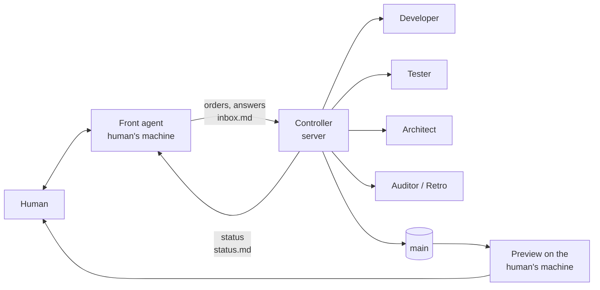
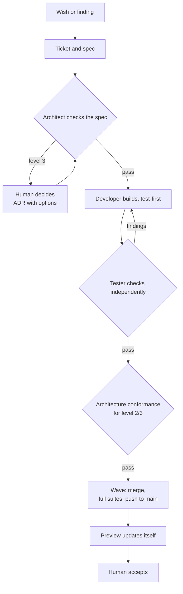
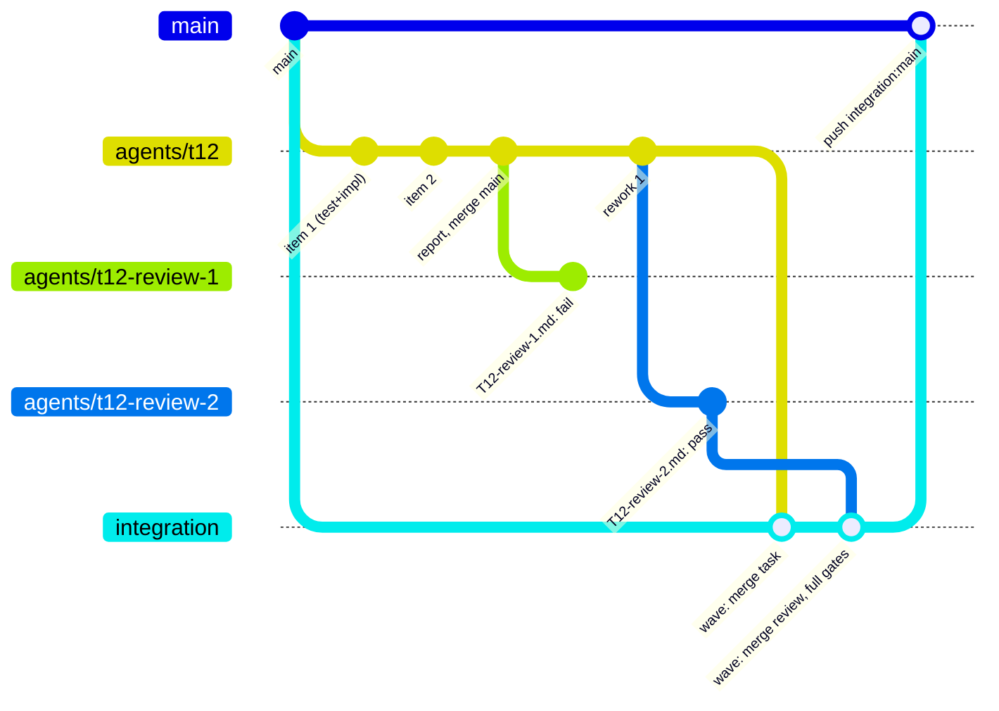

# The workflow: how software is built with this factory

**For:** people who want to understand how a project built with agentic-factory works, including third parties without prior knowledge.
**Binding for the agents** in a project are its `AGENTS.md`, `docs/coordinator.md` (rules and decision history), `docs/review-protocol.md` and `docs/architect-protocol.md`. This document summarises them and must agree with them.

## At a glance

A project is built by a small **agentic factory**:

- **The human** says what is needed, tests and decides. They talk to exactly one agent, the **Front agent**.
- The **Controller** runs unattended on a server. It distributes work to many **workers** (AI agents), schedules checks and brings finished work to `main`, at night too.
- **Quality comes from back pressure.** Nobody accepts their own work. Every change is checked by an independent Tester. Git technically refuses unreviewed code on `main`.

## Roles

| Role | Who / where | Does | Never does |
|---|---|---|---|
| **Human** | the owner | goals and priorities, accepts on the preview (their own machine, their own environment; automated tests never use real data), decides level-3 architecture and everything that touches real external systems or real data | – |
| **Front agent** | agent session on the human's machine | the only contact for the human. Takes wishes and test findings, turns them into tickets and specs, runs the outside-in stages, asks decisions one at a time, reports the status as a table, writes the morning handover | steer workers itself; burden the human with the workers' back-and-forth |
| **Controller** | agent session on the server, unattended | starts and steers all workers, schedules tests, reviews and waves, detects stuck workers, cleans up, writes a status after every cycle | talk to the human directly; take level-3, ADR or product decisions |
| **Developer** | worker (Codex, Claude Code or Pi) | builds exactly one task, test-first, on its own branch | push to `main`, weaken tests |
| **Tester** | worker, never the Developer of the task | checks independently against the spec, runs the full suites, writes findings with a verdict | change code |
| **Architect** | worker | checks specs before the build and the implementation afterwards against the architecture | change code; decide level 3 |
| **Auditor / Retro** | worker, read-only | evaluates where the factory loses time or makes mistakes and proposes improvements | change anything |

Workers are named by task and role, for example `T54 Meeting · Worker Tester`.

## Outside-in

New features are built **from the outside in**. Nothing is built until the surface, the data and the logic are agreed with the human. Details: [outside-in.md](outside-in.md).

| Stage | Produced | Tools | Human signs off |
|---|---|---|---|
| **1. Surface** | design drafts, then a clickable **front-end fake** with invented data and dummy actions | design MCP, `prototype` | how it looks and behaves |
| **2. Interfaces** | the data in and out, made visible on the fake | the fake | which data flows where |
| **3. Logic** | the flow in words and as a diagram | `grilling`, `wayfinder` | how the system decides |
| **4. Build** | spec, tickets, then Architect, Developer, Tester, wave | `to-spec`, `to-tickets`, Controller | acceptance on the preview |

Stages 1–3 happen with the human during the day; the Controller builds only what is signed off. Defects in already agreed behaviour go straight to the build. Design exports land in `design/<feature>/` in the repo so workers never need the design tool.

## The life of a task

1. **Ticket and spec:** goal, limits, acceptance criteria and the **architecture level**. Large efforts are cut into small, individually demonstrable slices first.
2. **Architecture before the build:** level 1 is inside one module; level 2 is a new interface, decided by the Controller; level 3 is new contracts, responsibilities, data flows or technology, decided by the human through an ADR with options and a recommendation. An Architect confirms the level. Building starts after its `pass`.
3. **Build:** a Developer builds test-first, keeps a checklist of every requirement, pushes after each item and self-reviews against the spec at the end.
4. **Independent test:** another worker checks against the spec and runs the full suites. Findings go back to the Developer; then a fresh Tester checks again.
5. **Conformance:** for levels 2 and 3 an Architect checks that the code implements the decided architecture, coarsely.
6. **Wave:** the Controller collects passed tasks and merges them. The full suites run once on the merged state, then it goes to `main`. A wave starts when two tasks are waiting, one has waited 60 minutes, or a task blocks others.
7. **Acceptance:** the human's preview pulls the new `main` automatically. The human tests there in their own environment, on a private copy where data is involved. Findings become new tickets.

**Bugs** take the same path. First a test must show the bug; no reproduction, no fix.

## Branches and worktrees: the mechanics of one ticket

Every ticket, whether a GitHub issue or a task file, becomes exactly one branch and one worktree per worker. Nothing is built in the main checkout.

| Step | Who | Where | What happens |
|---|---|---|---|
| 1. Ticket is `ready` | Front agent | issue `#12` or `docs/tasks/T12-<slug>.md` | goal, outside-in evidence, level, acceptance; a line in `inbox.md` |
| 2. Spec review | Architect (read-only) | branch `agents/t12-specreview` from `main` | commits only `docs/reviews/T12-architecture-spec.md`; `Verdict: pass` |
| 3. Build | Developer | **new worktree** `<workspaces>/<project>/t12/` on **new branch** `agents/t12` from `origin/main` | checklist of every acceptance item in the report; one item at a time: failing test, implementation, commit, **push after each item**; targeted checks only; self-review against the spec; merge `origin/main` at the end; report `docs/reports/T12-….md`; `worker_done` with branch and SHA |
| 4. Review round 1 | Tester (fresh context, read-only) | temporary branch from the reviewed SHA with `origin/main` merged in; findings on `agents/t12-review-1` | runs the full gates itself through `gate`; checks the flows; commits only `docs/reviews/T12-review-1.md` with `Reviewed commit: <SHA>` and `Verdict` |
| 5a. `fail` | Developer | **the same worktree and branch** `agents/t12` | fixes each finding test-first, commits, pushes; "Rework 1" in the report; a new Tester writes `T12-review-2.md` on `agents/t12-review-2` |
| 5b. `pass` | Architect (level 2/3 only) | `agents/t12-conformance` from the passed SHA | coarse boundary check, `T12-architecture-conformance.md` |
| 6. Wave | Controller | worktree `<workspaces>/<project>/coordinator-integration/`, branch `integration` reset to `origin/main` | merges each passed task branch **together with the review branch of its passing round** (`agents/t12` and `agents/t12-review-2`, plus the conformance branch for level 2/3), one branch at a time (an octopus merge is rejected by the push gate), carrying the merged commits' ADR references into the merge message, runs the full gates once, **pushes `integration` to `main`**; the pre-push hook verifies that every commit is an ancestor of a `Verdict: pass` review SHA found in the pushed tree |
| 7. Preview and acceptance | human | the preview clone on the human's machine | follows `main` automatically; findings become new tickets |
| 8. Cleanup | Controller, every cycle | all worker hosts | closes the worker's terminal, releases the dispatch, removes worktree `t12/` once its branch is merged or safely on origin, deletes merged `agents/t12*` branches, closes the issue or sets `Status: integrated` |

Rules that make this safe:

- **One worker, one worktree, one branch.** Several tickets run in parallel because their worktrees do not touch. The Controller never changes git state inside a running worker's worktree.
- **Push after every item.** A server restart loses nothing; the Controller restarts the worker in its worktree with a resume order.
- **Review branches are never overwritten.** Round numbers are part of the name, so the history of a ticket is complete.
- **Workers never push to `main`.** Only the wave does, and only with the review coverage the hook checks.
- **Branch names carry the ticket**: `agents/t12`, `agents/t12-review-<n>`, `agents/t12-conformance`, `agents/t12-specreview`. The prefix comes from `project.branchPrefix`. In GitHub-issue mode the number is the issue number.
- **Worktree names carry the ticket too**, so `ls <workspaces>/<project>` is the list of work in flight. More entries than tasks plus a few means cleanup is overdue.

## When what is checked

| Stage | Who | What |
|---|---|---|
| While building | Developer | targeted: types, lint, the affected tests, the browser tests for the change |
| Per task | Tester | **full**: verify and browser suites on current `main` plus the branch |
| Per wave | Controller | **full** on the merged state, then push to `main` |
| At release only | release gate | additionally the Docker checks, the **security and load tests**, and a browser acceptance through the human's addresses |

**Functional-only reviews:** a review fails only for real functional defects: a specified flow does not work or gives wrong results, data is lost, or a change would reach a real external system. Missing tests, coverage gaps, edge cases, security, load and style become debt with a follow-up and block nothing. After the configured number of review rounds (`reviews.maxRounds`, two by default) a working feature is integrated. **Nothing is dropped:** the debt is collected by category and worked off in a **hardening phase** once the functional breadth is there. The human starts it; the Front agent proposes it. **Always on:** code quality (`ponytail-review`, coding standards) and architecture conformance are checked in every review; an architecture violation blocks, quality findings are fixed when trivial or become debt. **Not in daily runs, mandatory before release:** load, security and the other deferred checks slow development down (observed), so they run in the hardening phase and before every release, as a condition of release approval; no release while such a debt item is open, unless the human accepts it in writing. Details: [reviews.md](reviews.md), [testing.md](testing.md).

**Push lock:** Git rejects every push to `main` not covered by a passing independent review. Architecture changes additionally need their approval.

**Realistic test data:** the demo data reproduces the *shapes* of the real data with invented content, because defects found only by the human usually came from test data that was too tidy.

## Where things run

| Place | What |
|---|---|
| **Worker hosts** | zero or more servers, or the human's own machine: workers, test runs, waves. A remote server is an option, not a must; several are fine |
| **Controller host** | one of the worker hosts, or the human's machine |
| **Human's machine** | Front agent; the **preview**: the current `main` with the human's real environment, read-only, on a private copy of their data where data is involved |
| **Git host** | the repository; all worker branches go there, never to `main` directly |

- **Capacity by measurement and calibration:** the Controller starts workers by measured pressure (CPU, memory and I/O stall time, available memory, gate queue, foreign load, quotas), not by a fixed count. The caps per host are starting values: they rise step by step while the host stays quiet and fall on pressure; the audit verifies. Gate slots adapt. Under pressure the order is critical path, nearly finished tasks, waves, new development, debt. Details: [capacity.md](capacity.md).
- **Gates:** test runs go through `gate`, fair in order, pooled by unit and browser tests.
- **Load log:** load, memory and pressure once a minute.

## Models

| Tier | For |
|---|---|
| default | development, all Testers, spec and architecture reviews |
| small | mechanical checklist work |
| large | ADRs and level-3 architecture |

**Escalation ladder:** two failures on the same task, and the next attempt runs one tier higher. **Quota fallback:** below 10 % of the default agent's weekly quota, new workers start with the fallback agent on the mapped tier; running workers finish; after the reset it switches back. **Calibration:** the tier per role is a starting value; measured pass rates and rounds from the journal move a role down when it passes easily and up when failures cluster.

Orders follow fixed **templates per role**: numbered steps, "done when", abort criteria, reply format. A spec is always generated from the template with parameters, never by editing another task's spec.

## Working with the human

The rhythm is a setting (`rhythm.mode`), not a rule:

- **Day plan, night build** (the default on the originating project): by day the human tests on the preview and talks to the Front agent, findings become tickets at once; by night the Controller works alone; in the morning a handover with the new state, open questions and acceptance items.
- **Continuous:** the Controller builds whenever signed-off work exists and asks as questions arise.
- **Custom:** quiet hours define when the Controller may start new work.
- **Status on request:** one table with task, who works on it (role, model), state, next step and whether the human is needed. Below it, what is new on `main` and open acceptance items.
- **Questions to the human:** always one at a time, with options and a recommendation.

## The Controller's cycle

On every worker event, otherwise every 10 minutes:

1. **Read events:** worker completions, questions and escalations, new inbox entries from the human, current `main`.
2. **React:** Developer done → Tester. Tester failed → rework in the same worktree, one tier higher after two failures, a question to the human after the round limit. Tester passed → conformance for level 2/3, else the next wave. Worker question → decide it if covered by the rules (level 1/2) and write the decision down, else ask the human.
3. **Detect stalls:** a stall watch reads every worker terminal. A worker sitting at its prompt, reporting the model at capacity, or stopping early with "incomplete" gets a nudge directly into its terminal. A message alone does not wake a waiting worker.
4. **Fill free capacity:** by the measured-capacity verdict and the priority order.
5. **Clean up, every cycle:** close the terminals of finished workers, release them, remove worktrees whose branch is merged or safely pushed (push a WIP branch first if anything is uncommitted), delete merged branches. Worktrees of active or paused tasks stay.
6. **Write the status:** `status.md` with a timestamp. The human's table is made from it.

## Handling disturbances

- **Tests under load:** known flakes may be rerun once, alone; three green isolated runs are the evidence. In a review an unchanged test that fails only by timeout under load does not fail the task. Root causes are fixed in their own tasks, never by weaker tests.
- **Foreign disturbances:** another project on the same host may churn the network; such runs count as environment and are repeated. The other project is never touched.
- **Merge conflicts in a wave:** the task's Developer resolves them on its branch; a Tester checks the resolution before the wave continues.
- **Server restart:** all agents are gone. The Controller inspects every worktree and restarts the workers in place with a resume order. Because every worker pushes regularly, nothing is lost.
- **Defects found by the human:** immediately a ticket and a retro trigger. The missing data shape goes into the demo data.

## Conventions

- **Numbers:** tickets are `T<n>`, each number exists once; check before creating. ADR numbers likewise.
- **Branches:** one per task; review branches carry task and round and are never overwritten.
- **Reports and findings:** `docs/reports/T<n>-….md` from the Developer, `docs/reviews/T<n>-review-<round>.md` from the Tester, `docs/reviews/<T>-architecture-….md` from the Architect.
- **Screenshots:** stay untracked under `.build/screenshots/` and are listed in the report; no binaries in git.
- **Decisions:** written down the moment they are made, with "decided by" and date. Details: [decisions.md](decisions.md).

## The factory improves itself

A journal of every event, a nightly **Pipeline Auditor**, a **retro** per hard agent run, a **fast lane** for small improvements (one at a time) and a **debt register**. Details: [improvement.md](improvement.md).

## Fixed rules, never negotiated

- **The factory has no outward effects.** Agents and their tests change nothing outside the repository and the demo or test environment: no production systems, no real accounts, no real data, no sending, deploying or deleting. Whether and how the *product* acts on external systems is a product decision of the project, recorded in its own docs.
- **The human's real data is untouchable:** tests run on demo data or a private copy. Nothing is written or deleted in the original.
- **No real data in the repo:** no company values, names, addresses or secrets in code, tests, fixtures or reports. `.env` is never committed, secrets are never printed.
- **Workers never push to `main`;** only reviewed state through a wave.
- **No bypassing hooks:** `--no-verify` is forbidden.
- **No real model calls in tests.**

## Tools and skills

| Tool | For |
|---|---|
| **Orca** or plain terminals | start workers in their own worktrees; messages between Controller and workers |
| **Git hooks** | commit: secret scan, protected files only with an ADR; push to `main`: passing review required |
| **Spec template** (`mkspec.mjs dev|rework|test|reeval|specreview|conf|audit|retro`) | uniform orders per role, always generated with parameters |
| **`gate`, load log, stall watch, `capacity.mjs`** | fair test runs, measurement, stuck workers, measured capacity |
| **Preview updater** | keeps the human's local preview on the current `main` |
| **ADRs** | every architecture decision with reasoning and "decided by" |

| Skill | For | Who |
|---|---|---|
| `grilling`, `grill-with-docs`, `domain-modeling`, `wayfinder`, `to-spec`, `to-tickets`, `prototype` | clarify, name things, plan, slice, fake | Front agent with the human |
| `tdd`, `diagnosing-bugs`, `ponytail` | build test-first and lean, reproduce bugs | Developer |
| `ponytail-review`, `code-review` | review independently | Tester |
| `ponytail-audit` | architecture health | Architect |
| `ponytail-debt` | the debt ledger for the hardening phase | Controller, Auditor |
| `retro` | improve the agents' environment after hard runs | Retro worker |
| `handoff`, `writing-for-agents` | handovers, orders and rules | Front agent, Controller |

Skills are vendored with pinned sources under `.agents/skills/`. Foreign skills are read completely before adoption; see `skills/SKILLS.md`.

## Where the rules come from

**This document is always kept current:** every new decision about the way of working goes in here at once, understandable for third parties, and in detail into `docs/coordinator.md`. Every rule traces to a decision with date and reason.
